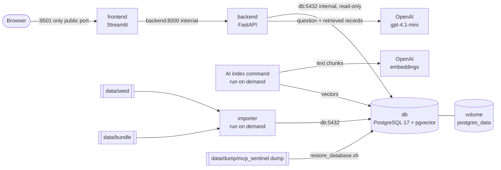

# Deployment

## You need

- Docker Desktop (Windows, macOS) or Docker Engine with Compose v2 (Linux).
- Git.
- Windows only: run the `.sh` scripts in Git Bash or WSL.

## Start the app

1. Download the project:
   ```bash
   git clone https://github.com/vokebetu/MCP-Sentinel.git
   cd MCP-Sentinel
   ```
2. Create the settings file:
   ```bash
   cp .env.example .env
   ```
3. Open `.env` and replace `replace-with-a-local-password` with any password. For the AI assistant, also set `OPENAI_API_KEY`. Never commit `.env`.
4. Start:
   ```bash
   docker compose up --build -d
   ```
5. Check. All three services must say `healthy` (about 1 minute):
   ```bash
   docker compose ps
   ```
6. The database starts empty. Load demo data (131 servers):
   ```bash
   docker compose run --rm importer seed
   ```
7. Build the AI search index (needs `OPENAI_API_KEY`, about 10 seconds):
   ```bash
   docker compose exec backend python -m app.ai index
   ```
8. Open <http://localhost:8501>. All pages except **AI assistant** work without an OpenAI key.

For the full database (50,019 servers), see "Load the full database" in `README.md`.

## Stop and start again

| Command | What it does |
|---|---|
| `docker compose stop` | Stop. Data is kept. |
| `docker compose up -d` | Start again. |
| `docker compose down -v` | Stop and **delete all data**. |

## 1. Architecture



- The browser talks only to the frontend.
- The app reads the database read-only.
- Only the importer and the AI index command write to it. Both run only when you start them.
- The OpenAI key stays in the backend. It is never sent to the browser.

## 2. Services and ports

| Service | Image | Port | Public? | Job |
|---|---|---|---|---|
| `frontend` | python:3.12-slim + Streamlit 1.66 | 8501 | yes | web app |
| `backend` | python:3.12-slim + FastAPI 0.162 | 8000 | no | API |
| `db` | postgres:17.11-alpine + pgvector 0.8.7 (`database/Dockerfile`) | 5432 | no | database and AI index |
| `importer` | python:3.12-slim | none | no | load and check data |

Health checks:

| Service | Check | Starts after |
|---|---|---|
| `db` | `pg_isready -h 127.0.0.1` | |
| `backend` | `GET /health` | `db` healthy |
| `frontend` | `GET /_stcore/health` | `backend` healthy |

## 3. Data and storage

| What | Where | Kept after `docker compose down`? |
|---|---|---|
| Database (about 660 MB when full) | Docker volume `mcp-sentinel_postgres_data` | yes (deleted only by `down -v`) |
| AI index | table `ai_chunks` in the database | yes |
| Table definitions | `database/schema/*.sql` (run once, on an empty volume) | file |
| Demo data | `data/seed/` | file, in Git |
| Full data bundle | `data/bundle/` | file, in Git |
| Full database backup | `data/dump/mcp_sentinel.dump` + `.sha256` | file, in Git |
| Source data for the bundle | `data/research/` | file, in Git |
| Your own backups | `artifacts/` | file, not in Git |

## 4. Configuration (`.env`)

| Variable | Used by | Purpose |
|---|---|---|
| `POSTGRES_DB` | db, backend, importer | database name |
| `POSTGRES_USER` | db, backend, importer | database user |
| `POSTGRES_PASSWORD` | db, backend, importer | password (required) |
| `FRONTEND_PORT` | compose | public port, default 8501 |
| `DB_POOL_SIZE` | backend | optional, default 5 |
| `OPENAI_API_KEY` | backend | needed only for the AI assistant |
| `OPENAI_CHAT_MODEL` | backend | optional, default `gpt-4.1-mini` |

## 5. Commands

A new install starts with an **empty** database. Load demo data or restore the dump (below).

| Task | Command |
|---|---|
| Build and start | `docker compose up --build -d` |
| Check status | `docker compose ps` |
| Check the API | `docker compose exec backend python -c "import urllib.request; print(urllib.request.urlopen('http://localhost:8000/health').read().decode())"` |
| Open the app | <http://localhost:8501> |
| Load demo data | `docker compose run --rm importer seed` |
| Load full data | `docker compose run --rm importer full` |
| Check the full data | `docker compose run --rm importer validate` |
| Build or update the AI index | `docker compose exec backend python -m app.ai index` |
| Check the AI setup | `docker compose exec backend python -c "import urllib.request; print(urllib.request.urlopen('http://localhost:8000/api/ai/status').read().decode())"` |
| Run report queries | `./scripts/run_report_queries.sh` |
| Open SQL shell | `docker compose exec db sh -c 'psql -U "$POSTGRES_USER" -d "$POSTGRES_DB"'` |
| Stop, keep data | `docker compose stop` or `docker compose down` |
| Stop, delete data | `docker compose down -v` |
| Back up | `./scripts/export_database.sh` (writes `artifacts/mcp_sentinel.dump`) |
| Restore into empty database | `./scripts/restore_database.sh data/dump/mcp_sentinel.dump` |
| Restore over existing data | `./scripts/restore_database.sh data/dump/mcp_sentinel.dump --replace` |

`restore_database.sh` does these steps:

1. Checks the `.sha256`.
2. Refuses to overwrite data unless `--replace` is given.
3. Stops backend and frontend.
4. Recreates the database.
5. Runs `pg_restore`.

After it finishes, run `docker compose up -d`.

**Restore without Docker** (PostgreSQL 17 with the pgvector extension installed; the dump uses zstd compression):

```bash
createdb mcp_sentinel
pg_restore --no-owner --no-privileges -d mcp_sentinel mcp_sentinel.dump
```

**Test a restore on a separate copy** (port 8502):

```bash
COMPOSE_ARGS="-p mcp-sentinel-restoretest" ./scripts/restore_database.sh data/dump/mcp_sentinel.dump
docker compose -p mcp-sentinel-restoretest run --rm importer validate
FRONTEND_PORT=8502 docker compose -p mcp-sentinel-restoretest up -d --wait
docker compose -p mcp-sentinel-restoretest down -v
```

## 6. Known issues

- Vulnerabilities were checked only for 400 sample servers. 48,269 of 48,673 non-deleted servers show "not assessed".
- Endpoint status is from 2026-10-22, not live.
- The importer loads the whole bundle into memory (about 115 MB).
- A database created before the AI update has no `ai_chunks` table. The AI page shows an error until you run the migration in section 7.
- If your shell already exports `OPENAI_API_KEY`, it overrides `.env`. Run `unset OPENAI_API_KEY`, then `docker compose up -d --force-recreate backend`.

## 7. AI assistant

| Part | Setting |
|---|---|
| Embeddings | `text-embedding-3-small`, 512 dimensions |
| Answers | `OPENAI_CHAT_MODEL` (default `gpt-4.1-mini`), Responses API, `store: false`, temperature 0 |
| Search | pgvector HNSW (cosine) + full-text + exact server and CVE/GHSA matches |
| Sources per answer | 5 by default, 10 at most |
| Limits | question 1,500 characters, history 6 turns, 4 requests at a time |
| Index contents | latest version of each non-deleted server, active findings, one methodology note |
| Index updates | only changed text is sent again; old chunks are removed after a full successful run |

API:

| Route | Does |
|---|---|
| `GET /api/ai/status` | key present (not tested), model names, chunk count, last index time |
| `POST /api/ai/chat` | `question`, `history`, `strategy` (`zero_shot`/`few_shot`), `top_k`, `use_retrieval` |

Add the AI table to a database made before the AI update (keeps all data):

```bash
docker compose up -d --build
docker compose exec -T db sh -c 'psql -v ON_ERROR_STOP=1 -U "$POSTGRES_USER" -d "$POSTGRES_DB"' < database/schema/003_ai.sql
docker compose exec backend python -m app.ai index
```

New empty databases get the table automatically.

Run the AI evaluation (written for the demo data; up to 36 OpenAI requests):

```bash
docker compose exec backend python -m app.ai evaluate
docker compose cp backend:/tmp/ai-evaluation.json docs/AI_EVALUATION.json
```
