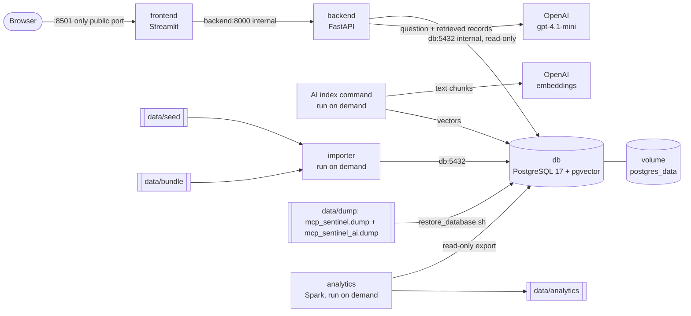

# Deployment

## You need

- Docker Desktop (Windows, macOS) or Docker Engine with Compose v2 (Linux).
- Git.
- Windows only: run the `.sh` scripts in Git Bash or WSL.

## Start the app

1. Download the project:
   ```bash
   git clone https://github.com/vokebetu/MCP-Sentinel.git
   cd MCP-Sentinel
   ```
2. Create the settings file:
   ```bash
   cp .env.example .env
   ```
3. Open `.env` and replace `replace-with-a-local-password` with any password. For the AI assistant, also set `OPENAI_API_KEY`. Never commit `.env`.
4. Start:
   ```bash
   docker compose up --build -d
   ```
5. Check. All three services must say `healthy` (about 1 minute):
   ```bash
   docker compose ps
   ```
   Upgrading a database made by an older version of MCP Sentinel? Run `docker compose run --rm importer migrate` once. It adds new tables and keeps your data.
6. The database starts empty. Load demo data (131 servers):
   ```bash
   docker compose run --rm importer seed
   ```
7. Build the AI search index (needs `OPENAI_API_KEY`, about 10 seconds):
   ```bash
   docker compose exec backend python -m app.ai index
   ```
8. Open <http://localhost:8501>. All pages except **AI assistant** work without an OpenAI key.

For the full database (50,019 servers), follow "Quick start: full database" in `README.md`.

## Stop and start again

| Command | What it does |
|---|---|
| `docker compose stop` | Stop. Data is kept. |
| `docker compose up -d` | Start again. |
| `docker compose down -v` | Stop and **delete all data**. |

## 1. Architecture



- The browser talks only to the frontend.
- The app reads the database read-only.
- Only the importer and the AI index command write to it. Both run only when you start them.
- The analytics service only reads from the database and writes files to `data/analytics/`.
- The OpenAI key stays in the backend. It is never sent to the browser.

## 2. Services and ports

| Service | Image | Port | Public? | Job |
|---|---|---|---|---|
| `frontend` | python:3.12-slim + Streamlit 1.66 | 8501 | yes | web app |
| `backend` | python:3.12-slim + FastAPI 0.162 | 8000 | no | API |
| `db` | postgres:17.11-alpine + pgvector 0.8.7 (`database/Dockerfile`) | 5432 | no | database and AI index |
| `importer` | python:3.12-slim | none | no | load and check data, add new tables |
| `analytics` | python:3.12-slim + Java 21 + PySpark 4.0.1 (`analytics/Dockerfile`) | none | no | Spark ETL, SQL reports, K-Means |

Health checks:

| Service | Check | Starts after |
|---|---|---|
| `db` | `pg_isready -h 127.0.0.1` | |
| `backend` | `GET /health` | `db` healthy |
| `frontend` | `GET /_stcore/health` | `backend` healthy |

## 3. Data and storage

| What | Where | Kept after `docker compose down`? |
|---|---|---|
| Database (about 1.1 GB when full) | Docker volume `mcp-sentinel_postgres_data` | yes (deleted only by `down -v`) |
| AI index | table `ai_chunks` in the database | yes |
| Table definitions | `database/schema/*.sql` (run once, on an empty volume) | file |
| Demo data | `data/seed/` | file, in Git |
| Full data bundle | `data/bundle/` | file, in Git |
| Full database backup | `data/dump/mcp_sentinel.dump` (data) + `mcp_sentinel_ai.dump` (AI index), each with `.sha256` | file, in Git |
| Source data for the bundle | `data/research/` | file, in Git |
| Spark outputs | `data/analytics/` | file, not in Git |
| Your own backups | `artifacts/` | file, not in Git |

## 4. Configuration (`.env`)

| Variable | Used by | Purpose |
|---|---|---|
| `POSTGRES_DB` | db, backend, importer | database name |
| `POSTGRES_USER` | db, backend, importer | database user |
| `POSTGRES_PASSWORD` | db, backend, importer | password (required) |
| `FRONTEND_PORT` | compose | public port, default 8501 |
| `DB_POOL_SIZE` | backend | optional, default 5 |
| `DB_POOL_TIMEOUT` | backend | optional, seconds a request waits for a free database connection, default 10 |
| `OPENAI_API_KEY` | backend | needed only for the AI assistant |
| `OPENAI_CHAT_MODEL` | backend | optional, default `gpt-4.1-mini` |

## 5. Commands

A new install starts with an **empty** database. Load demo data or restore the dump (below).

| Task | Command |
|---|---|
| Build and start | `docker compose up --build -d` |
| Check status | `docker compose ps` |
| Check the API | `docker compose exec backend python -c "import urllib.request; print(urllib.request.urlopen('http://localhost:8000/health').read().decode())"` |
| Open the app | <http://localhost:8501> |
| Load demo data | `docker compose run --rm importer seed` |
| Load full data | `docker compose run --rm importer full` |
| Check the full data | `docker compose run --rm importer validate` |
| Add new tables to an older database | `docker compose run --rm importer migrate` |
| Run Spark analytics | `docker compose run --rm analytics` |
| Look up all packages again (research) | `.venv/bin/python -I scripts/enrich_packages.py` |
| Build or update the AI index | `docker compose exec backend python -m app.ai index` |
| Check the AI setup | `docker compose exec backend python -c "import urllib.request; print(urllib.request.urlopen('http://localhost:8000/api/ai/status').read().decode())"` |
| Run the AI benchmark | `./scripts/run_benchmark.sh run --repeat 3` (section 11) |
| Run report queries | `./scripts/run_report_queries.sh` |
| Open SQL shell | `docker compose exec db sh -c 'psql -U "$POSTGRES_USER" -d "$POSTGRES_DB"'` |
| Stop, keep data | `docker compose stop` or `docker compose down` |
| Stop, delete data | `docker compose down -v` |
| Back up | `./scripts/export_database.sh` (writes `artifacts/mcp_sentinel.dump` and `artifacts/mcp_sentinel_ai.dump`) |
| Restore into empty database | `./scripts/restore_database.sh data/dump/mcp_sentinel.dump` |
| Restore over existing data | `./scripts/restore_database.sh data/dump/mcp_sentinel.dump --replace` |

`restore_database.sh` does these steps:

1. Checks the `.sha256` of both files.
2. Refuses to overwrite data unless `--replace` is given.
3. Stops backend and frontend.
4. Recreates the database.
5. Runs `pg_restore` for the data, then for the AI index if `mcp_sentinel_ai.dump` is next to the data file.

After it finishes, run `docker compose up -d`.

**Restore without Docker** (PostgreSQL 17 with the pgvector extension installed; the dump uses zstd compression):

```bash
createdb mcp_sentinel
pg_restore --no-owner --no-privileges -d mcp_sentinel mcp_sentinel.dump
pg_restore --no-owner --no-privileges -d mcp_sentinel mcp_sentinel_ai.dump
```

**Test a restore on a separate copy** (port 8502):

```bash
COMPOSE_ARGS="-p mcp-sentinel-restoretest" ./scripts/restore_database.sh data/dump/mcp_sentinel.dump
docker compose -p mcp-sentinel-restoretest run --rm importer validate
FRONTEND_PORT=8502 docker compose -p mcp-sentinel-restoretest up -d --wait
docker compose -p mcp-sentinel-restoretest down -v
```

## 6. Known issues

- Vulnerability lookups need an npm, PyPI, NuGet or Cargo package with an exact version (16,514 servers). 30,150 remote-only servers have no package to check; Docker images and MCPB files are not covered.
- Endpoint status is from 2026-10-22, not live.
- The importer loads the whole bundle into memory. A full import takes about 8 minutes.
- A database made by an older version lacks new tables. The AI page then shows the fix: `docker compose run --rm importer migrate`.
- If your shell already exports `OPENAI_API_KEY`, it overrides `.env`. Run `unset OPENAI_API_KEY`, then `docker compose up -d --force-recreate backend`.

## 7. AI assistant

| Part | Setting |
|---|---|
| Embeddings | `text-embedding-3-small`, 512 dimensions |
| Answers | `OPENAI_CHAT_MODEL` (default `gpt-4.1-mini`), Responses API, `store: false`, temperature 0 |
| Storage | `halfvec(512)` (half-size floats) in table `ai_chunks` |
| Search | pgvector HNSW (cosine) + full-text + exact server and CVE/GHSA matches |
| Questions about counts, shares or rankings | live SQL statistics over the whole database are added as sources |
| Questions naming a CVE or GHSA id | live SQL statistics for that advisory are added as sources |
| Sources per answer | 5 by default, 10 at most |
| Limits | question 1,500 characters, history 6 turns, 4 requests at a time |
| Index contents | latest version of each non-deleted server, all findings of each server (grouped), one methodology note |
| Index updates | only changed text is sent again; old chunks are removed after a full successful run |

API:

| Route | Does |
|---|---|
| `GET /api/ai/status` | key present (not tested), model names, chunk count, last index time, `prompt_sha256` (changes when the prompt changes) |
| `POST /api/ai/chat` | `question`, `history`, `strategy` (`zero_shot`/`few_shot`), `top_k`, `use_retrieval`, `server_ids` (up to 4: scope) |

How answers are built:

| Question | Extra evidence |
|---|---|
| Counts, shares, rankings | live SQL statistics over the whole database |
| Critical, high severity, "dangerous" | live SQL list by highest recorded advisory severity (not a risk score) |
| Not assessed, not applicable, coverage | live SQL counts per assessment state |
| Tool metadata, input schemas | live SQL counts per tool metadata state |
| A CVE or GHSA id | live SQL count of servers with that advisory |
| A named, follow-up or selected server | exact SQL lookups: the stored registry record (version, status, deployment, packages, repository, snapshot date) and the assessment record (advisory state, checks, tool metadata) |
| A server name that is not in the registry | fixed answer "not in the stored registry snapshot" with the snapshot date and record count; no model call |
| Direct advisories | live SQL count and ranking of servers with direct package findings (ties by name) |
| Requests to write poems, stories or jokes | fixed redirect to MCP security questions; no model call |
| Definitions ("what does … mean") | the methodology note |
| Broad discovery ("find three …") | at least 8 retrieved sources, never more than 10 |

Answers cite sources inline as `[1]`, `[2]`. Every number is checked against the sources actually supplied; unknown references are removed, and an answer without any verified citation is shown as "insufficient evidence".

Which servers an answer uses (first match wins):

1. Servers named in the question by exact registry name. Selected servers are added only if the question says "selected".
2. A follow-up ("it", "those two"): the servers the previous answer used.
3. The selected scope.
4. Otherwise the whole database. Count and ranking questions ("how many servers …") use the whole database even when servers are selected.

The response returns `scope`, `scope_source`, `ignored_scope` (selected but not used) and `not_found`. The app shows "Scope used" under each answer. "New chat" clears the conversation and the scope.

Notes under an answer: one per server and only for security questions, when the answer does not already say it (not applicable, unknown, tools not observed). Lists of servers with findings get one coverage note, and "checked, none found" answers get a "not proof of safety" note, when the answer leaves them out.

Add the AI table to a database made by an older version (keeps all data):

```bash
docker compose up -d --build
docker compose run --rm importer migrate
docker compose exec backend python -m app.ai index
```

New empty databases get the table automatically.

Run the AI evaluation on the full database (31 questions, each with and without retrieval and with two prompts: up to 124 OpenAI requests, about $0.07):

```bash
docker compose exec backend python -m app.ai evaluate
docker compose cp backend:/tmp/ai-evaluation.json docs/AI_EVALUATION.json
```

## 8. Review checklist and SBOM

The **Review checklist** tab on each server profile lists the evidence a bank's third-party risk review asks for.

| Item | Source |
|---|---|
| Identifiable publisher | registry namespace (verified GitHub account or domain) |
| Source repository and activity | GitHub lookup |
| Pinned versions | registry package declarations |
| Known vulnerabilities | OSV (declared packages and modeled dependencies) |
| SBOM | deps.dev dependency list |
| Signed builds and provenance | deps.dev (SLSA provenance, attestations), PyPI |
| Tool permission review | PolicyLayer labels, publisher tool annotations |
| Prompt injection hints | text patterns over stored tool descriptions (view `tool_review_flags`) |
| Tool definition fingerprint | SHA-256 over tool names, descriptions and input schemas |
| Secrets and logins it needs | registry record (secret settings, login headers) |
| Static code analysis | always "not assessed": code is never downloaded |

Each item has a status (`present`, `missing`, `not_assessed`, `not_applicable`) and a "needs attention" flag. Status says whether evidence exists, not whether the server is safe.

| Route | Does |
|---|---|
| `GET /api/servers/{id}/review` | checklist, tool review hints, fingerprint |
| `GET /api/servers/{id}/sbom` | CycloneDX 1.5 JSON from the stored dependency list (404 if none) |
| `GET /api/servers?tool_hints=true` | servers with at least one tool review hint |

The profile page offers the checklist as JSON or Markdown, and the SBOM as JSON.

## 9. Spark analytics

```bash
docker compose run --rm analytics
```

1. Exports four database views to CSV (read-only connection).
2. Bronze: the CSVs as Parquet. Silver: typed columns. Gold: one row per server version with coverage and model eligibility.
3. Runs the four Spark SQL reports in `analytics/analysis.sql`.
4. Trains K-Means (k up to 3, seed 42, 80/20 split) on servers with completed vulnerability checks only, and reports the test silhouette.

Outputs go to `data/analytics/output/` (`metrics.json`, `sql/`, `ml/`, Parquet layers). About 40 seconds on the full database. Cluster numbers are not safety ratings.

Run the Spark tests (they need Java, so they run in the container):

```bash
docker compose run --rm --entrypoint python analytics -m pytest -q tests/test_analytics.py
```

## 10. Search API, export and troubleshooting

| Route | Does |
|---|---|
| `GET /api/servers` | one page of results; filters `q`, `status`, `ecosystem`, `deployment`, `has_repository`, `github`, `assessment`, `has_tools`, `tool_info` (repeatable: `listed`, `count_observed`, `observed_none`, `not_observed`), `tool_hints`; `sort`, `page`, `page_size` |
| `GET /api/servers/export` | every matching server, same filters and order, streamed as JSON lines; the app turns it into CSV |

Search counts and pages on cheap columns, then computes the security summary only for the rows on the page. On the full database a page takes about 0.03 s sorted by name, 0.3 s sorted by concerns, and under 0.9 s with an assessment filter and the concerns sort. 60 concurrent page requests all succeed. The API turns off PostgreSQL JIT for its own connections, because compiling these short queries cost up to 0.45 s each.

Rows per page: 10, 25, 50 or 100 (the API accepts 1–100). Changing it keeps the first visible row on screen and keeps selections on other pages.

Look: `frontend/.streamlit/config.toml` holds the theme (`[theme]`, `[theme.sidebar]`). Text inputs, the chat box and select boxes are white with a `#8C93A0` border (3:1 contrast) and a blue focus ring; disabled ones stay grey. The CSS is in `THEME_CSS` in `frontend/app.py` and targets Streamlit `data-testid` attributes, not generated class names.

Every API response carries an `X-Request-ID` header. The backend logs one JSON line per request (`request_id`, `path`, `status`, `ms`) and a `database_error` line with a reason when the database fails:

| HTTP 503 `reason` | Meaning | What to do |
|---|---|---|
| `database_busy` | no database connection became free within `DB_POOL_TIMEOUT` | retry; raise `DB_POOL_SIZE` if it repeats |
| `query_timeout` | a query ran longer than 15 seconds | report the request id |
| `database_unavailable` | the database cannot be reached | `docker compose ps`, then `docker compose logs db` |
| `schema_missing` | tables are missing | `docker compose run --rm importer migrate` |

Find a request in the logs: `docker compose logs backend | grep <request id>`.

## 11. AI benchmark

28 questions with known answers (`docs/benchmark/cases.json`), plus one prompt-injection check that is reported but not counted. Each answer is scored on five things: correct value, correct wording for unknown / not applicable / checked-none-found, correct servers, valid citations, short answer without raw source IDs.

The correct answers come from read-only SQL on the base tables, not from the AI code, and are frozen per registry snapshot in `docs/benchmark/gold/`. The gold file for the shipped database is already in the repository.

Needs the app running with `OPENAI_API_KEY` and the AI index. One run is about 31 requests (about $0.03).

```bash
./scripts/run_benchmark.sh run --repeat 3
```

| Option | Does |
|---|---|
| `--repeat N` | run every case N times (1–5) and report cases whose result changed |
| `--cases 01,25,26` | run only these cases |
| `--strategy zero_shot` | use the zero-shot prompt (default `few_shot`) |

After loading different data, freeze new correct answers first (refuses to overwrite unless `--force`):

```bash
./scripts/run_benchmark.sh freeze
```

`run` stops if the database no longer matches the frozen answers. Each run writes `docs/benchmark/results/<time>_<model>_<test set>.json` and `.md` (every answer, sources, scores, failures with expected vs actual) and adds one line to `docs/benchmark/history.csv` (model, prompt fingerprint, index date, Git commit, pass rate). Old results are never overwritten. Run it again after any change to the prompt, model, index or SQL routing.

