# MCP Sentinel: Database Architecture and Implementation

- **Team #2:** Sana Shaik, Shreem Dixit, Sahir Shaik, Dias Utebekov
- **Data:** Official MCP Registry snapshot, 2026-10-23

## 1. Overview

**Goal:** store every MCP Registry server with its software, known vulnerabilities, evidence, and which checks were done.

| Part | Result |
|---|---|
| Database | PostgreSQL 17 + pgvector: 24 tables, 5 views, 75 indexes |
| Registry import | 50,019 servers (48,673 not deleted) |
| Package lookup | every declared npm, PyPI, NuGet and Cargo package version (16,669) in deps.dev and OSV, 2026-11-14 |
| Research data import | OSV, deps.dev, NVD, CVE.org, EPSS, CISA KEV, GitHub, npm, PyPI, Agora, PolicyLayer, ToolHive |
| Vulnerability coverage | 16,514 servers checked; 30,150 remote-only servers have no package to check |
| Security findings | 19,406 findings on 6,048 servers |
| Coverage records | 317,347 checks |
| Review checklist | per server: the evidence a bank's third-party review asks for, plus an SBOM download |
| AI assistant | answers with numbered sources from 55,477 indexed records (OpenAI embeddings + `gpt-4.1-mini`); 28-question benchmark with SQL-checked answers: 84/84 over 3 runs; 31/31 evaluation questions with either prompt |
| Spark analytics | Bronze/Silver/Gold Parquet, 4 SQL reports, K-Means on 16,514 servers |
| App | FastAPI + Streamlit in Docker Compose |
| Backup | two dump files (37 MB data, 77 MB AI index), restore tested |
| Tests | 105 automated tests, 42 database checks, 28-question AI benchmark |

## 2. Data Modeling and Database Design

### A. Data modeling review

| Problem found in the data | Change in the model |
|---|---|
| A server has versions; a package has its own versions | separate `servers`, `server_versions`, `packages`, `package_versions` |
| 2,238 package declarations have no exact version | version link may be empty; no fake versions |
| 741 GitHub repositories are shared by several servers | separate `repositories` table |
| One vulnerability has several IDs (CVE, GHSA, PYSEC) | `advisories` + `advisory_identifiers` |
| "No result" can mean checked, impossible, or never checked | `assessment_checks` with explicit outcomes |

### B. Conceptual model

| Entity | Main attributes | Relationships |
|---|---|---|
| Server | registry name, status | has 1+ versions |
| Server version | version, title, description, dates | declares 0+ packages; links 0–1 repository; exposes 0+ endpoints |
| Repository | URL, GitHub id, archived, last push | shared by 1+ server versions |
| Package / package version | ecosystem, name / version, publish date | a version is declared by 0+ servers |
| Dependency resolution / edge | root version, date, status / from, to | a version has 0+ resolutions; a resolution has 0+ edges |
| Advisory / identifier | canonical id, summary, severity / CVE, GHSA, PYSEC | an advisory has 1+ identifiers |
| Security finding | category, method, status, dates | 1 server version, 1 advisory, 1 package version |
| Assessment check | type, outcome, source, date | 1 server version, optional package |
| Evidence observation | source, date, payload | supports findings, checks, tools, endpoint data |
| Tool / endpoint observation | tool name, schema / availability, tool count | 1 server version |
| CVE observation | CVSS, EPSS, KEV | per CVE and source |

```mermaid
erDiagram
    servers ||--|{ server_versions : "has"
    servers |o--o| server_versions : "latest_version_id"
    server_versions ||--o{ server_repositories : "links"
    repositories ||--o{ server_repositories : "is linked by"
    server_versions ||--o{ server_package_declarations : "declares"
    packages ||--o{ server_package_declarations : "is declared as"
    packages ||--o{ package_versions : "has"
    package_versions |o--o{ server_package_declarations : "exact version (nullable)"
    server_versions ||--o{ remote_endpoints : "exposes"
    package_versions ||--o{ dependency_resolutions : "is root of"
    dependency_resolutions ||--o{ dependency_edges : "contains"
    package_versions |o--o{ dependency_edges : "from / to (nullable)"
    advisories ||--|{ advisory_identifiers : "is known as"
    advisories ||--o{ advisory_affected_packages : "affects"
    packages ||--o{ advisory_affected_packages : "is affected in"
    server_versions ||--o{ security_findings : "has"
    advisories ||--o{ security_findings : "explains"
    package_versions ||--o{ security_findings : "affected version"
    server_package_declarations ||--o{ security_findings : "supports"
    dependency_resolutions |o--o{ security_findings : "supports (dependency only)"
    evidence_observations ||--o{ security_findings : "evidence"
    server_versions ||--o{ assessment_checks : "is assessed by"
    server_package_declarations |o--o{ assessment_checks : "scope"
    data_sources ||--o{ assessment_checks : "performed by"
    data_sources ||--o{ collection_runs : "imported in"
    collection_runs ||--o{ evidence_observations : "loaded"
    data_sources ||--o{ evidence_observations : "from"
    evidence_observations |o--o{ advisory_identifiers : "OSV record"
    evidence_observations ||--o{ advisory_affected_packages : "source record"
    evidence_observations ||--|| dependency_resolutions : "graph"
    server_versions ||--o{ tool_observations : "offers"
    evidence_observations ||--o{ tool_observations : "listing"
    server_versions ||--o{ endpoint_observations : "observed"
    remote_endpoints |o--o{ endpoint_observations : "declared endpoint (nullable)"
    evidence_observations ||--|| endpoint_observations : "evidence"
    data_sources ||--o{ cve_observations : "from"
    collection_runs ||--o{ import_errors : "logs"
    servers ||--o{ ai_chunks : "AI text"
    server_versions ||--o{ ai_chunks : "AI text"
```

### C. Logical model

| Table | Primary key | Unique key | Foreign keys |
|---|---|---|---|
| `servers` | `server_id` | `registry_name` | `latest_version_id` |
| `server_versions` | `server_version_id` | (`server_id`, `version`) | `server_id`, `run_id` |
| `repositories` | `repository_id` | `canonical_url`; `github_id` | |
| `server_repositories` | (version, repository, subfolder) | same | both |
| `packages` | `package_id` | (`ecosystem`, `normalized_name`) | |
| `package_versions` | `package_version_id` | (`package_id`, `version`) | `package_id` |
| `server_package_declarations` | `declaration_id` | (`server_version_id`, `position`) | server version, package, package version (nullable) |
| `remote_endpoints` | `endpoint_id` | (`server_version_id`, `position`) | server version |
| `advisories` | `advisory_id` | `canonical_id` | |
| `advisory_identifiers` | `identifier` | same | advisory, evidence |
| `advisory_affected_packages` | `affected_id` | (`source_record_id`, `entry_index`) | advisory, package, evidence |
| `dependency_resolutions` | `resolution_id` | (root, source, `resolved_at`) | root version, source, evidence |
| `dependency_edges` | `edge_id` | (`resolution_id`, `from_node`, `to_node`) | resolution, from/to versions (nullable) |
| `security_findings` | `finding_id` | (server version, advisory, package version, category) | server version, advisory, package version, declaration, resolution, evidence |
| `assessment_checks` | `check_id` | `check_key` | server version, declaration, resolution, repository, endpoint, source, run, evidence |
| `evidence_observations` | `observation_id` | (`source_id`, `observation_key`) | source, run, optional entity links |
| `tool_observations` | `tool_observation_id` | (`observation_id`, `tool_position`) | server version, evidence, endpoint |
| `endpoint_observations` | `endpoint_observation_id` | `observation_id` | server version, endpoint, evidence |
| `cve_observations` | `cve_observation_id` | (`cve_id`, `source_id`, `observed_at`) | source, evidence |
| `data_sources` | `source_id` | `source_key` | |
| `collection_runs` | `run_id` | | source |
| `import_errors` | `error_id` | | run |
| `schema_migrations` | `version` | | |
| `ai_chunks` | `chunk_key` | same | server, server version (both nullable) |

| View | Purpose |
|---|---|
| `server_profiles` | one row per server: counts, ecosystems, deployment type |
| `server_security_summary` | findings and assessment state per server |
| `advisory_cve_context` | CVSS, EPSS, KEV per advisory CVE |
| `cve_latest_observations` | newest value per CVE and source |
| `tool_review_flags` | text-pattern hints in tool descriptions (hidden instructions, invisible characters, key or config file mentions, tool redirects) |

### D. Schema design decisions

- **Normalised (3NF):** shared repositories, packages and advisories are stored once.
- **Kept on purpose:** the original registry record (`registry_record`) as a source copy.
- **Unknown = `NULL`:** never 0 or false. Unassessed servers have `NULL` advisory counts.
- **No fake data:** inexact declarations get no package version (`CHECK`). A dependency finding needs a graph (`CHECK`).
- **History:** dependency graphs and CVE data are keyed by date.
- **Versions** are compared with PEP 440 (PyPI) and SemVer (npm), never as plain text.

| Type | Used for |
|---|---|
| `BIGINT GENERATED ALWAYS AS IDENTITY` | all ids |
| `TEXT` | names, URLs, versions |
| `TIMESTAMPTZ` | all times |
| `NUMERIC` + `CHECK` | CVSS 0–10, EPSS 0–1 |
| `BOOLEAN` (nullable) | `NULL` = not observed |
| `JSONB` | original registry record, version ranges, tool schemas, source payloads |
| `TSVECTOR` | keyword search |
| `halfvec(512)` | AI text embeddings (half-size floats) |

| Index | For |
|---|---|
| GIN `tsvector`, GIN trigram on name | keyword and partial-name search |
| status, package, declaration indexes | filters and joins |
| advisory identifier indexes | alias lookup |
| findings and checks by server | profile pages |
| checks by (type, outcome) | coverage statistics |
| HNSW (cosine) on `ai_chunks.embedding`, GIN on chunk text | AI search |

**Assessment outcomes:**

| Outcome | Meaning |
|---|---|
| `finding_found` / `no_known_finding` | vulnerability check found something / nothing |
| `evidence_found` / `not_found` | other lookup found a record / no record |
| `missing_identifier` | registry record lacks the needed ID |
| `not_applicable` / `unsupported` | e.g. package check on a remote-only server / OCI package in OSV |
| `access_restricted` / `error` | API key needed / lookup failed |

`not_assessed` is never stored. It is shown when no check exists.

**Finding categories:**

| Category | Meaning |
|---|---|
| `direct_package` | declared exact version is inside the advisory range |
| `resolved_dependency` | a deps.dev graph of the declared package contains an affected version (modeled, not proof of installation) |

- Advisory IDs are grouped through OSV `aliases`: 476 records → 280 advisories.
- Counts use `count(DISTINCT advisory_id)`.

## 3. Database Technology Evaluation

| Technology | Role | Advantage | Limitation |
|---|---|---|---|
| Relational (PostgreSQL) | main store | foreign keys, constraints, joins, JSONB, full-text search, one dump | long graph paths are verbose |
| Document (MongoDB) | raw API documents | flexible schema | no foreign keys; duplicated data |
| Graph (Neo4j) | dependency paths | natural path queries | second system; our 2.16 million edges are only read one server's graph at a time |
| Time-series | repeated observations | time windows | only one snapshot |
| Vector (pgvector) | AI search | finds similar text inside PostgreSQL | added as an extension for the AI assistant |
| Data lake | raw archives | cheap storage | too heavy for a database of about 1.1 GB |

**Selected: PostgreSQL 17 with pgvector.**

- Constraints enforce the safety rules: no finding without evidence, no fake versions, one advisory per identifier.
- One engine, one backup file. AI vectors live next to the facts they describe.
- Supports search, filters, profiles, comparison and statistics.

No benchmarks were run.

## 4. Database Architecture

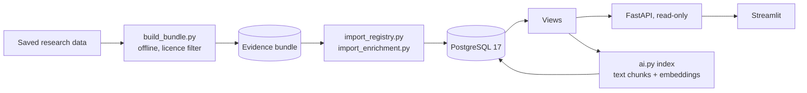

| Step | What happens |
|---|---|
| Package lookup | `enrich_packages.py` looks up every declared package once (deps.dev, OSV, CVE.org, EPSS) and saves every answer |
| Ingestion | `build_bundle.py` reads saved files (no internet) and keeps only redistributable sources |
| Storage | importers load the bundle in one transaction each; every fact gets a source and a date |
| Access | FastAPI runs parameterised, read-only queries; Streamlit calls FastAPI |
| AI index | `python -m app.ai index` turns profiles and findings into text chunks with embeddings |
| Analytics | `docker compose run --rm analytics` exports views read-only, then Spark builds Parquet layers, SQL reports and K-Means |
| Updates | re-import changes nothing; new snapshots add history |

## 5. Database Implementation

### Rows loaded

| Table | Rows |
|---|---|
| `servers` / `server_versions` | 50,019 / 50,019 |
| `repositories` / `server_repositories` | 27,323 / 34,005 |
| `packages` / `package_versions` | 36,853 / 43,243 |
| `server_package_declarations` | 20,456 |
| `remote_endpoints` | 33,965 |
| `advisories` / `advisory_identifiers` | 1,363 / 3,327 |
| `dependency_resolutions` / `dependency_edges` | 16,263 / 2,158,770 |
| `security_findings` | 19,406 (94 direct, 19,312 dependency) on 6,048 servers |
| `assessment_checks` | 317,347 |
| `evidence_observations` | 86,920 |
| `tool_observations` | 16,055 (620 servers with valid schemas) |
| `endpoint_observations` | 31,485 |
| `cve_observations` | 4,204 |
| `import_errors` | 0 |
| `ai_chunks` | 55,477 |

### Data sources

| Loaded source | Licence |
|---|---|
| Official MCP Registry, GitHub, npm, PyPI | public metadata, attribution |
| OSV, GitHub Advisory Database, deps.dev, Agora, PolicyLayer | CC BY 4.0 |
| CISA KEV | CC0 |
| ToolHive | Apache-2.0 |
| NVD | US government work (notice required) |
| CVE.org | CVE Terms of Use |
| FIRST EPSS | free, attribution requested |

| Not loaded | Reason |
|---|---|
| RMCP.dev | terms forbid redistribution |
| SecureChain KG, Vulnerable MCP Project, MCP CVE Project | no licence stated |
| Docker MCP Catalog, MCPShield | not needed (no JSON Schema / repository grades only) |
| Glama | API key required |

Rule: only individual records are loaded. Summary counts are never turned into rows.

### Check against the research measurements

| Measure | Measured in research (2026-10-23) | Database |
|---|---|---|
| Registry records | 50,019 | 50,019 |
| Active / deprecated / deleted | 48,056 / 617 / 1,346 | same |
| Package declarations / remote endpoints | 20,175 / 32,726 | same |
| Shared GitHub repositories | 741 | 741 |
| Declarations without exact version | 2,238 | 2,238 |
| Package versions checked for vulnerabilities | 400-server sample | all 16,669 (lookup of 2026-11-14) |
| `praisonai@2.3.42` advisories | 80 | 81 (one advisory published after 2026-10-23) |
| Servers with valid tool schemas | 620 | 620 |
| Known-vulnerable test packages detected | 10/10 | 10/10 |

### Tests

| Test | Result |
|---|---|
| Automated tests (`pytest`) | 105 passed: 16 unit, 9 frontend helper, 20 database, 38 API, 17 browser (including three live AI tests), 5 Spark |
| AI benchmark (`./scripts/run_benchmark.sh`) | 84/84 over 3 runs (28 questions) |
| Database checks (`importer validate`) | 42/42 passed |
| Import twice | identical row counts |
| `docker compose down` + `up` | data kept |
| Restore both dump files on a new volume | 3 minutes, 42/42 passed, identical counts, AI index works |
| Public ports | only 8501 |
| Secrets in dump | none |

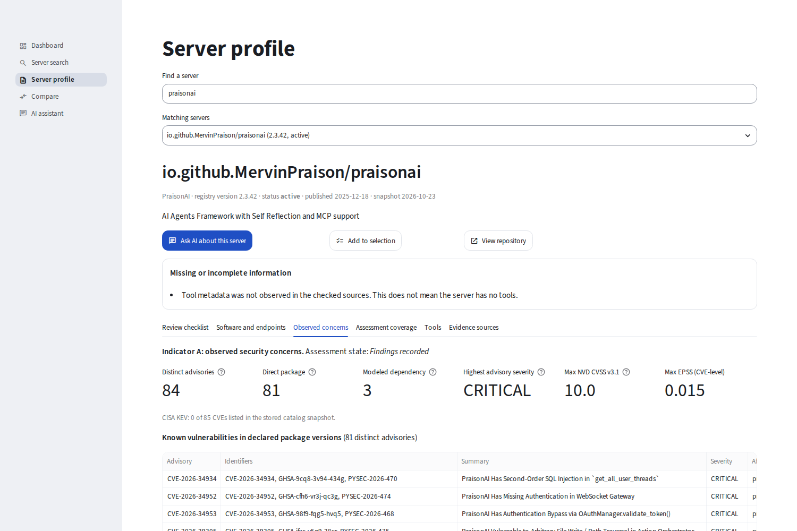

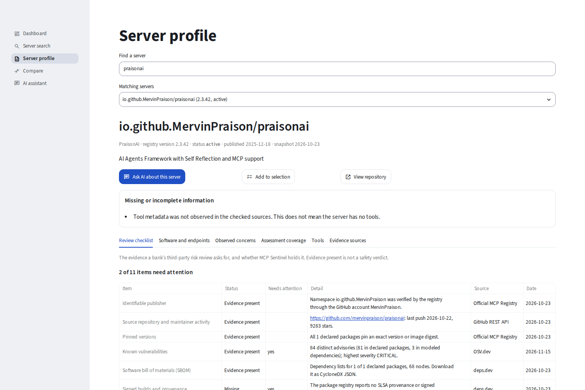

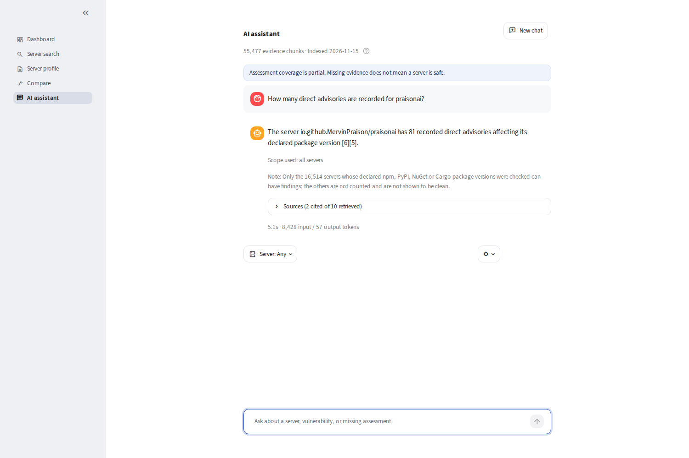

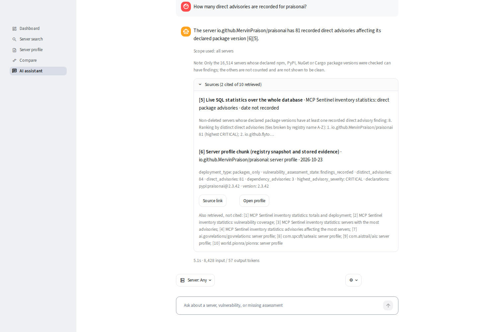

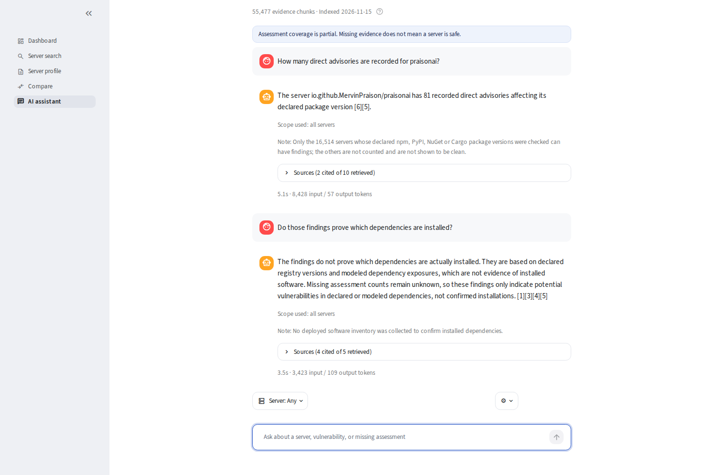

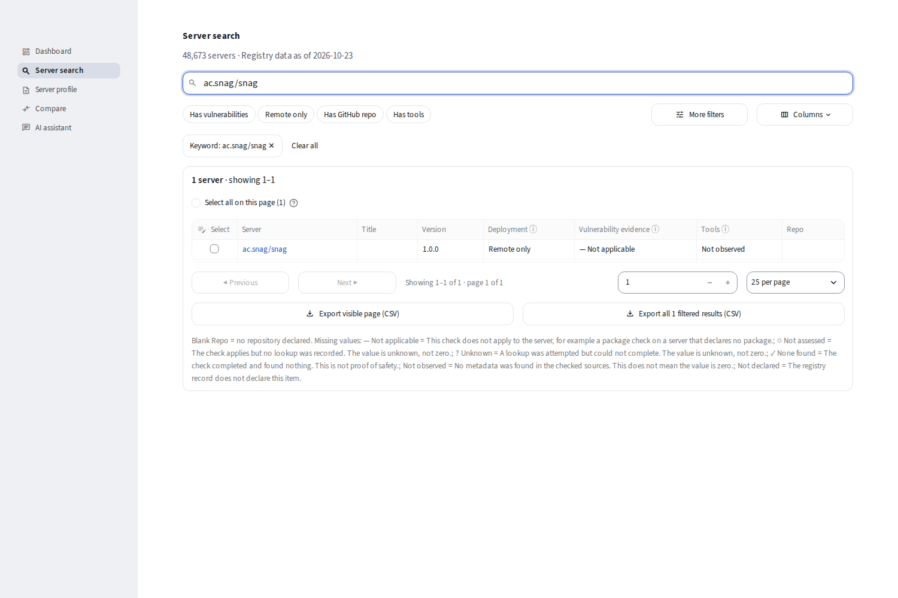

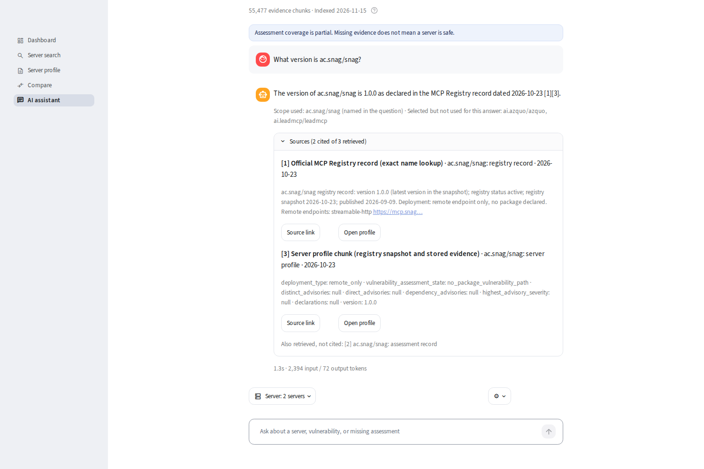

## 6. Query and Retrieval Demonstration

Queries: `database/queries/report_queries.sql`. Run: `./scripts/run_report_queries.sh`.

### Query 1: servers per package ecosystem

Uses joins, `GROUP BY`, `count(DISTINCT)`, and handles servers with several ecosystems.

| ecosystem | servers | package_declarations | servers_also_in_another_ecosystem | pct_of_inventory |
|---|---|---|---|---|
| (no package declared) | 30150 | 0 | 0 | 61.9 |
| (distinct servers with any package) | 18523 | 20175 | 725 | 38.1 |
| npm | 11770 | 12054 | 416 | 24.2 |
| pypi | 4688 | 4711 | 412 | 9.6 |
| mcpb | 1393 | 1928 | 217 | 2.9 |
| oci | 1209 | 1229 | 416 | 2.5 |
| nuget | 158 | 158 | 24 | 0.3 |
| cargo | 95 | 95 | 30 | 0.2 |

### Query 2: vulnerabilities of one server (`io.github.MervinPraison/praisonai`)

Shows the declared version, advisories, CVEs, severity, fixed versions, and direct versus dependency findings. First 8 of 84 rows, plus the three dependency rows:

| category | advisory | CVE | other IDs | severity | NVD CVSS | EPSS | affected | fixed in |
|---|---|---|---|---|---|---|---|---|
| direct_package | CVE-2026-39305 | CVE-2026-39305 | GHSA-jfxc-v5g9-38xr, PYSEC-2026-475 | CRITICAL | 10.0 | 0.00318 | praisonai@2.3.42 | 4.5.113 |
| direct_package | CVE-2026-47392 | CVE-2026-47392 | GHSA-4mr5-g6f9-cfrh, PYSEC-2026-463, PYSEC-2026-483 | CRITICAL | 9.9 | 0.00884 | praisonai@2.3.42 | 4.6.40 |
| direct_package | CVE-2026-61445 | CVE-2026-61445 | GHSA-9mp3-24cc-77mg, PYSEC-2026-4253 | CRITICAL | 9.9 | 0.00640 | praisonai@2.3.42 | 4.6.78 |
| direct_package | CVE-2026-34934 | CVE-2026-34934 | GHSA-9cq8-3v94-434g, PYSEC-2026-470 | CRITICAL | 9.8 | 0.00543 | praisonai@2.3.42 | 4.5.90 |
| direct_package | CVE-2026-39890 | CVE-2026-39890 | GHSA-32vr-5gcf-3pw2, PYSEC-2026-462 | CRITICAL | 9.8 | 0.00589 | praisonai@2.3.42 | 4.5.115 |
| direct_package | CVE-2026-40288 | CVE-2026-40288 | GHSA-vc46-vw85-3wvm, PYSEC-2026-477, PYSEC-2026-488 | CRITICAL | 9.8 | 0.00619 | praisonai@2.3.42 | 4.5.139 |
| direct_package | CVE-2026-41497 | CVE-2026-41497 | GHSA-9qhq-v63v-fv3j, PYSEC-2026-473 | CRITICAL | 9.8 | 0.00541 | praisonai@2.3.42 | 4.5.149 |
| direct_package | CVE-2026-47391 | CVE-2026-47391 | GHSA-vg22-4gmj-prxw, PYSEC-2026-478 | CRITICAL | 9.8 | 0.01498 | praisonai@2.3.42 | 4.6.40 |
| resolved_dependency | GHSA-x462-jjpc-q4q4 | none | GHSA-x462-jjpc-q4q4 | HIGH | none | none | praisonaiagents@1.7.14 | 4.5.128 |
| resolved_dependency | CVE-2026-56074 | CVE-2026-56074 | GHSA-ffp3-3562-8cv3, PYSEC-2026-2946 | MODERATE | 5.5 | 0.00176 | praisonaiagents@1.7.14 | 4.5.128 |
| resolved_dependency | CVE-2026-126360 | CVE-2026-126360 | GHSA-mf5v-w3w3-f6cg | MODERATE | none | 0.00519 | opentelemetry-api@1.45.1 | 1.45.2 |

Summary:

| category | findings | distinct advisories | CVE IDs | critical or high | max CVSS | max EPSS | in KEV |
|---|---|---|---|---|---|---|---|
| direct_package | 81 | 81 | 83 | 65 | 10.0 | 0.01498 | 0 |
| resolved_dependency | 3 | 3 | 2 | 1 | 5.5 | 0.00519 | 0 |

- Aliases are grouped: 81 advisories, 83 CVEs.
- NVD scores exist only for CVEs from the research sample; the new dependency CVE shows `none`.
- Missing values stay missing (`none`), never 0.
- EPSS is per CVE, not a chance that this server is hacked.

### Query 3: two servers compared, with coverage

Two PyPI servers. In the October research sample only the first was checked; the full package lookup now covers both.

| | io.github.Buer2333/tiktok-shop-mcp | io.github.06ketan/medium-ops |
|---|---|---|
| package | pypi:tiktok-shop-mcp@0.3.0 | pypi:medium-ops@0.1.2 |
| repository | GitHub lookup: found | GitHub lookup: not checked |
| direct advisories | 0 | 0 |
| dependency advisories | 1 (advisory published after 2026-10-23) | 0 |
| assessment state | findings recorded | no known findings in completed checks |
| meaning | one modeled dependency exposure | no known advisories (not proof of safety) |

`0` means checked. `NULL` means never checked: the 30,150 remote-only servers keep `NULL` because they have no package to check.

## 7. AI Assistant

**Goal:** answer questions about the stored data in plain language, with sources, and keep the rule "unknown is not zero".

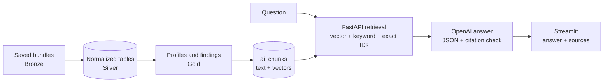

| Layer | Contents |
|---|---|
| Bronze | saved registry and evidence bundles (`data/`) |
| Silver | normalized tables: versions, packages, advisories, findings, checks |
| Gold | SQL views and `ai_chunks`: one text record per server profile and one per server's findings, with source URL, date and hash |

| Step | How |
|---|---|
| Chunks | one JSON text per server profile and per server's findings; long ones split at 2,400 characters with 240 overlap |
| Embeddings | `text-embedding-3-small`, 512 dimensions, stored as `halfvec`, batches of 32, 2 workers |
| Updates | content hash per chunk; unchanged chunks are not sent again; old chunks removed only after a full run |
| Retrieval | HNSW cosine + full-text + exact server name and CVE/GHSA match; top 5 |
| Inventory questions | counts, shares and rankings get live SQL statistics over the whole database as extra sources |
| Advisory questions | a CVE or GHSA id in the question adds live SQL counts of the servers it affects |
| Prompts | zero-shot or few-shot (4 examples); strict JSON answer schema |
| Citations | must be IDs of retrieved sources; checked again in code |
| Guards | named server not found, or "compromised today?": answer is "not enough evidence" |
| Safety | questions use the read-only connection; key only in the backend; `store: false` |

Indexing, measured on the full database:

| Chunks | Embedding tokens | Time | Rerun without changes |
|---|---|---|---|
| 55,477 (48,673 profiles, 6,801 findings, 1 note) | about 17.0 million | about 13 min | 0 chunks sent, 65 s |

### Answer quality across question types

Answers were good for questions about one server but varied for other kinds of questions. A 22-question check on the full data showed where:

| Question type | Before | After | What went wrong before |
|---|---|---|---|
| Named server, everyday name, concepts, search, comparison | 12/12 | 12/12 | |
| Counts over the whole database | 0/5 | 5/5 | counted the 5 retrieved records: "There are 5 MCP servers in the database", "100% are remote-only" |
| Rankings | 0/2 | 2/2 | "None of the servers have vulnerabilities" |
| CVE lookups | 1/2 | 2/2 | right servers, but named by internal ids |
| Decline when unsure | 1/1 | 1/1 | |
| **Total** | **14/22** | **22/22** | |

Fixes: live SQL statistics for inventory and advisory questions, a prompt rule against counting the sample, and server names instead of ids.

Evaluation (`docs/AI_EVALUATION.json`): full data, 31 questions in 12 categories × 2 prompts × retrieval on/off = 124 runs. Expected answers for data-dependent questions are computed from the database when the evaluation runs. Server-scoped questions pass the server as the chat scope.

| Prompt | Retrieval | Passed | Mean time | Input / output tokens |
|---|---|---|---|---|
| Zero-shot | yes | 30/31 | 4.0 s | 182,445 / 6,196 |
| Few-shot (default) | yes | 31/31 | 3.5 s | 194,978 / 5,509 |
| Zero-shot | no | 2/31 | 1.1 s | 18,412 / 1,821 |
| Few-shot | no | 2/31 | 1.1 s | 30,682 / 1,590 |

- Retrieval makes the difference: without it only the two "decline" questions pass.
- Checks are term matches; the answers for counts, rankings and CVEs were also read by hand.
- The zero-shot miss gives a correct answer ("a package vulnerability assessment does not apply") but labels it "insufficient evidence".
- All 57 grounded answers cite their sources inline as `[n]`, and every number maps to a supplied source.
- 31 questions do not measure general accuracy.

| Problem found during evaluation | Fix |
|---|---|
| Answered about a similar server when the named one was missing | name check, then "not enough evidence" |
| Missed an exact CVE | exact CVE/GHSA match in retrieval |
| Cited sources it was not given | citation choices limited to retrieved IDs, checked in code |
| Said vulnerable dependencies were installed | interpretation rule and few-shot example |
| Plain words in a question ("graph", "server") matched server names | a short name counts only if exactly one server has it |
| Search took 7.7 s | vector index used directly, cheaper keyword ranking: 0.4–0.7 s |
| Counted retrieved records as the whole database | live SQL statistics; prompt forbids counting the sample |
| One CVE can affect 100+ servers; top 5 cannot list them | live SQL counts per advisory |
| 19,406 findings would mean 19,406 vectors and partial lists | one findings record per server (6,801 records) |
| Newlines inside JSON glued "n" to the next word, so exact CVE search missed | findings separated with " \| " |
| Index scan of the full data took about 40 minutes | planner set for full scans: the scan takes 1.4 s |
| One network error stopped a long index run | up to two retries for connection errors |
| Dump would pass GitHub's 100 MB file limit | vectors stored as `halfvec`; AI index in its own dump file |
| A remote-only server read as "no vulnerabilities" | live SQL facts for scoped or named servers: package lookup "not applicable" |
| "Most dangerous" read as a verdict | severity statistics state that recorded severity is not a risk score |
| Definition questions retrieved unrelated profiles | the methodology note is added for definition questions |
| An uncited answer was labelled grounded | shown as "insufficient evidence" instead |

### Scope fix

With `ai.azquo/azquo` and `ai.leadmcp/leadmcp` still selected, "What version is ac.snag/snag?" got "The server ac.snag/snag is not present in the provided evidence", with 0 of 4 sources cited and four notes about the two selected servers. The server is in the registry (version 1.0.0).

| Cause | Fix |
|---|---|
| A server named in the question was looked up only when nothing was selected, so retrieval stayed limited to the old selection | names in the question are looked up first, by exact registry name, and win over the selection |
| "New chat" kept the selection, and the chat showed the selection, not what was used | "New chat" clears the scope; each answer shows "Scope used" and "Selected but not used" |
| Version and status came from approximate vector search | each scoped server gets two exact SQL sources: its stored registry record and its assessment record (`registry:<name>@<version>`, `assessment:<name>@<version>`) |
| "Not retrieved" and "not in the database" looked the same | a name that is not in the registry gets a fixed "not in the stored registry snapshot" answer with the snapshot date |
| Coverage notes repeated for every selected server | one note per server in scope, only for security questions, only when the answer does not already say it |

Order: named in the question, then a follow-up ("it", "those two": the servers of the previous answer), then the selection, then the whole database. Count and ranking questions use the whole database even with a selection.

### Benchmark with known answers

`docs/benchmark/`: 28 questions in 17 categories (registry facts, vulnerability state, tool metadata, provenance, comparison, safety limits, counts, SQL examples and ranking, checked-none-found, unknown, modeled exposure, missing field, not in snapshot, scope regression, follow-up, off topic), plus one prompt-injection check that is not counted.

- Correct answers come from read-only SQL on the base tables, frozen for the snapshot in `gold/2026-10-23_0a110721fbc4_50019.json`. The 12 facts from the reported screenshots all match the database.
- Each answer is scored on value, wording of unknown / not applicable / checked-none-found, servers used, citations (exist, right server, right snapshot date, no invented markers) and length. A case passes only if every check passes.

`gpt-4.1-mini`, few-shot prompt:

| Test set | Change | Passed |
|---|---|---|
| 1.0 | first run | 25/28 (89.3%) |
| 1.1 | scorer: "not specified" accepted for tools; off-topic needs a real redirect | 80/84 (95.2%), 3 runs |
| 1.2 | poem check also counts escaped line breaks; cases 24 and 28 only | 2/6 (the model wrote the poem) |
| 1.3 | scorer reads the notes shown under the answer; fixed redirect for poems; list and coverage rules | 82/84 (97.6%), 3 runs |
| 1.3 | "not proof of safety" note | **84/84 (100%)**, 3 runs, no case changed between runs |

- Median answer time 1.8 s, mean 2.3 s (one slow model reply of 21.5 s).
- Not every pass is the model's own wording: case 23 (unknown name) and case 28 (poem) are fixed answers, and in 2 of 3 runs the "not proof of safety" caveat for case 19 came from the note under the answer.
- Checks are text patterns and SQL sets; single sentences are not checked automatically.
- Rerun after any prompt, model, index or SQL change: `./scripts/run_benchmark.sh run --repeat 3`. Every run is kept in `docs/benchmark/results/` and `docs/benchmark/history.csv`.

The original 31-question evaluation on the final code (`docs/benchmark/results/20261122_original_31_question_evaluation.json`): with retrieval 31/31 for both prompts (zero-shot 4.0 s, few-shot 3.7 s), without retrieval 2/31.

### Search reliability and usability

Search pages failed with HTTP 503 under quick clicking. Each page recomputed the security summary for all 48,673 servers (317,347 coverage checks) before taking 25 rows, so overlapping requests held all 5 database connections past the 5-second wait.

| Measure (full database) | Before | After |
|---|---|---|
| One search page | 0.55 s | 0.10 s |
| 30 concurrent page requests | 5 × HTTP 503 | all succeed (slowest 0.37 s) |
| 60 concurrent page requests | not tested | all succeed (slowest 0.66 s) |

The new query filters, sorts and counts on cheap columns, then computes the summary only for the page. For all 50,019 servers it returns the same states and counts as the original views (0 differences).

| Issue | Fix |
|---|---|
| Tools showed 0 for 47,638 servers without tool data, including 15,470 with a known handshake tool count | four states: listed, handshake count, observed none, not observed |
| Filters, selections and chat reset when changing pages | kept in session state for the whole browser session |
| Result checkboxes allowed one row | real multi-select across pages, "Select all on this page", selection bar |
| CSV did not match the screen | one formatter for screen and CSV; "visible page" and "all filtered results" exports |
| Compare listed 20+ equal-weight rows | summary cards, grouped sections, differences highlighted, provenance collapsed |
| "Has vulnerabilities" sorted by concerns took 1.8 s | per-row lookup of findings instead of a join the planner misjudged (same order for all 50,019 servers), and PostgreSQL JIT off for the API's short queries: 0.85 s |
| Fixed 25 rows per page | 10, 25, 50 or 100 rows; the first visible row stays on screen; selections and exports follow the chosen size |
| Grey text boxes looked disabled | theme in `frontend/.streamlit/config.toml`; search box, chat box and select boxes white with a 3:1 contrast border and a focus ring; disabled ones stay grey |

## 8. Review Checklist

Reviewer feedback asked what evidence a bank should require before using an MCP server that has no known vulnerabilities but was never fully assessed. The profile page now answers that per server.

| Item | Evidence used | Coverage |
|---|---|---|
| Identifiable publisher | registry namespace: verified GitHub account or domain | every server |
| Source repository and activity | GitHub lookup | 287 repositories checked |
| Pinned versions | exact versions or image digests in the registry record | every package |
| Known vulnerabilities | OSV, declared packages and modeled dependencies | 16,514 servers |
| SBOM | deps.dev dependency list, downloadable as CycloneDX 1.5 | 16,263 dependency lists |
| Signed builds and provenance | deps.dev SLSA provenance and attestations | 2,773 and 4,880 of 16,406 package versions |
| Tool permission review | PolicyLayer labels, publisher annotations | 1,037 servers with tools |
| Prompt injection hints | text patterns over tool descriptions | 24 servers with hints |
| Tool definition fingerprint | SHA-256 of tool names, descriptions and schemas | 1,037 servers with tools |
| Secrets and logins it needs | registry record | every server |
| Static code analysis | not run (code is never downloaded) | none |

- Every item says whether evidence exists, not whether the server is safe.
- Hints were read by hand: the one hidden-instruction hit is a security scanner's own example text; most key mentions are wallet tools that ask for a private key.
- Not built: sandboxing, pinned deployments and a logging gateway. These are the bank's runtime controls.

## 9. Spark Analytics

A second processing path runs batch analytics without changing the app.

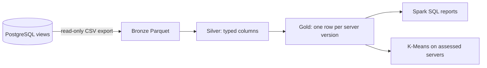

| Layer | Rows |
|---|---|
| Bronze | 50,019 profiles, 50,019 security summaries, 280,126 check groups, 6,051 finding groups |
| Gold | 50,019 server versions, 16,514 eligible for clustering |

Coverage by assessment state (Spark SQL):

| State | Servers |
|---|---|
| no package to check | 30,150 |
| completed vulnerability checks | 16,514 |
| checks could not complete | 2,009 |
| not assessed (deleted records) | 1,346 |

| K-Means | Result |
|---|---|
| Features | packages, remotes, repositories, tools, completed and incomplete checks, distinct advisories |
| Train / test | 13,283 / 3,231 (80/20, seed 42) |
| Clusters | 3 (test sizes 2,931 / 172 / 128) |
| Test silhouette | 0.71 |

- Clusters group similar evidence profiles. They are not safety ratings.
- Most servers share one profile; the two small clusters hold the servers with many advisories or many tools.
- First run fixes: `numpy` was missing for Spark ML, a test built empty untyped columns, and `randomSplit` ran on an uncached join (could crash or overlap rows).

## 10. Updated System Architecture

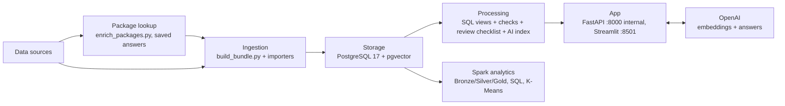

| Change from the first design | Reason |
|---|---|
| Official MCP Registry is the only identity source | other lists could not be linked reliably |
| Offline, repeatable import | same input gives the same database |
| Coverage is its own table | "not checked" must be visible |
| One database engine, with pgvector | see Section 3 |
| Every declared package looked up, not a sample | "not assessed" dropped from 48,269 servers to none |
| Review checklist per server | reviewer feedback: show the evidence a bank asks for |
| Spark path beside the app | batch analytics without changing the operational database |
| AI index in its own dump file | each file stays under GitHub's 100 MB limit |
| Exact registry lookups before vector search | a server named in a question must not be missed because of retrieval or an old selection |
| Benchmark with answers frozen from SQL | measure AI quality again after any prompt, model or index change |

## 11. Reflection

**Hard:**

- Knowing which research files had real records and which had only counts.
- Getting identities right: shared repositories, alias IDs, inexact versions.
- Showing what was never checked, without storing fake rows. After the full package lookup, every current server has a recorded state.
- Making the AI say "not enough evidence" instead of guessing.

**Worked well:**

- Comparing every count with the source snapshot.
- Re-checking all 19,406 findings against advisory version ranges: all agreed.
- Saving every API answer, so the package lookup can be rebuilt without sending a request again.
- Storing the dated KEV catalog, so "not listed" is a real answer.

**Learned:**

- A security database must record what is unknown.
- Database constraints catch data mistakes early.
- A backup counts only after a restore is tested.
- AI answers need the same rule as the database: unknown stays unknown.
- Counting questions need SQL, not a sample of retrieved text.

## 12. Checklist

| Item | Done |
|---|---|
| Conceptual model | yes |
| Logical schema | yes |
| Technology evaluation | yes |
| Storage architecture | yes |
| Database implemented and loaded | yes |
| 3 queries with results | yes |
| Updated architecture | yes |
| App runs with Docker Compose | yes |
| Backup restores on a new volume | yes |
| AI assistant with sources | yes |
| AI evaluation | yes |
| Full package vulnerability lookup | yes |
| Review checklist and SBOM | yes |
| Spark ETL, SQL reports and K-Means | yes |
| AI benchmark with known answers, rerunnable | yes |
