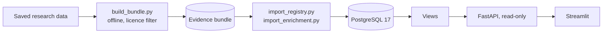
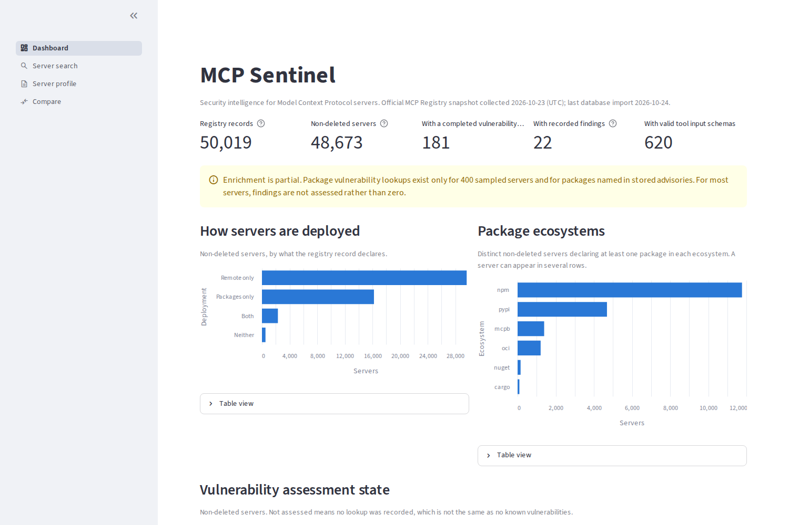
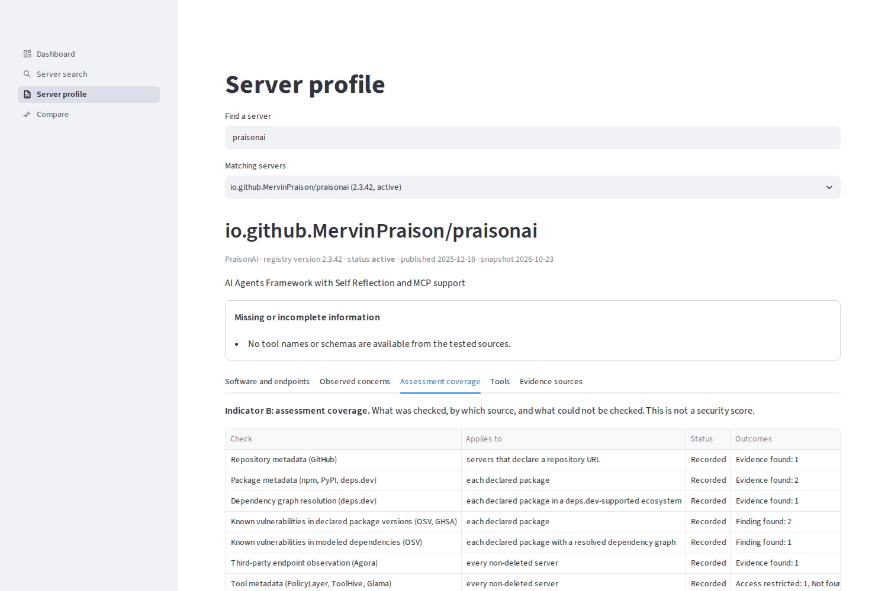
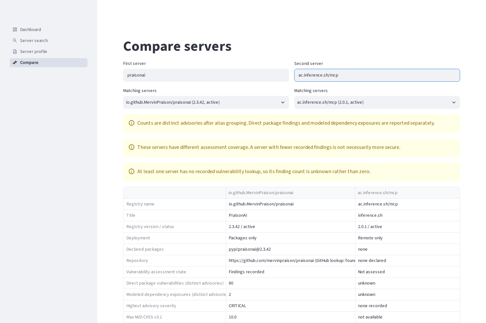
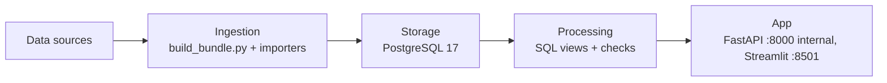

# MCP Sentinel: Database Architecture and Implementation

- **Team #2:** Sana Shaik, Shreem Dixit, Sahir Shaik, Dias Utebekov
- **Data:** Official MCP Registry snapshot, 2026-10-23

## 1. Overview

**Goal:** store every MCP Registry server with its software, known vulnerabilities, evidence, and which checks were done.

| Part | Result |
|---|---|
| Database | PostgreSQL 17: 23 tables, 4 views, 71 indexes (29 secondary) |
| Registry import | 50,019 servers (48,673 not deleted) |
| Research data import | OSV, deps.dev, NVD, CVE.org, EPSS, CISA KEV, GitHub, npm, PyPI, Agora, PolicyLayer, ToolHive |
| Security findings | 204 findings on 22 servers |
| Coverage records | 148,923 checks |
| App | FastAPI + Streamlit in Docker Compose |
| Backup | 26 MB dump, restore tested |
| Tests | 50 automated tests, 42 database checks |

## 2. Data Modeling and Database Design

### A. Data modeling review

| Problem found in the data | Change in the model |
|---|---|
| A server has versions; a package has its own versions | separate `servers`, `server_versions`, `packages`, `package_versions` |
| 2,238 package declarations have no exact version | version link may be empty; no fake versions |
| 741 GitHub repositories are shared by several servers | separate `repositories` table |
| One vulnerability has several IDs (CVE, GHSA, PYSEC) | `advisories` + `advisory_identifiers` |
| "No result" can mean checked, impossible, or never checked | `assessment_checks` with explicit outcomes |

### B. Conceptual model

| Entity | Main attributes | Relationships |
|---|---|---|
| Server | registry name, status | has 1+ versions |
| Server version | version, title, description, dates | declares 0+ packages; links 0–1 repository; exposes 0+ endpoints |
| Repository | URL, GitHub id, archived, last push | shared by 1+ server versions |
| Package / package version | ecosystem, name / version, publish date | a version is declared by 0+ servers |
| Dependency resolution / edge | root version, date, status / from, to | a version has 0+ resolutions; a resolution has 0+ edges |
| Advisory / identifier | canonical id, summary, severity / CVE, GHSA, PYSEC | an advisory has 1+ identifiers |
| Security finding | category, method, status, dates | 1 server version, 1 advisory, 1 package version |
| Assessment check | type, outcome, source, date | 1 server version, optional package |
| Evidence observation | source, date, payload | supports findings, checks, tools, endpoint data |
| Tool / endpoint observation | tool name, schema / availability, tool count | 1 server version |
| CVE observation | CVSS, EPSS, KEV | per CVE and source |

```mermaid
erDiagram
    servers ||--|{ server_versions : "has"
    servers |o--o| server_versions : "latest_version_id"
    server_versions ||--o{ server_repositories : "links"
    repositories ||--o{ server_repositories : "is linked by"
    server_versions ||--o{ server_package_declarations : "declares"
    packages ||--o{ server_package_declarations : "is declared as"
    packages ||--o{ package_versions : "has"
    package_versions |o--o{ server_package_declarations : "exact version (nullable)"
    server_versions ||--o{ remote_endpoints : "exposes"
    package_versions ||--o{ dependency_resolutions : "is root of"
    dependency_resolutions ||--o{ dependency_edges : "contains"
    package_versions |o--o{ dependency_edges : "from / to (nullable)"
    advisories ||--|{ advisory_identifiers : "is known as"
    advisories ||--o{ advisory_affected_packages : "affects"
    packages ||--o{ advisory_affected_packages : "is affected in"
    server_versions ||--o{ security_findings : "has"
    advisories ||--o{ security_findings : "explains"
    package_versions ||--o{ security_findings : "affected version"
    server_package_declarations ||--o{ security_findings : "supports"
    dependency_resolutions |o--o{ security_findings : "supports (dependency only)"
    evidence_observations ||--o{ security_findings : "evidence"
    server_versions ||--o{ assessment_checks : "is assessed by"
    server_package_declarations |o--o{ assessment_checks : "scope"
    data_sources ||--o{ assessment_checks : "performed by"
    data_sources ||--o{ collection_runs : "imported in"
    collection_runs ||--o{ evidence_observations : "loaded"
    data_sources ||--o{ evidence_observations : "from"
    evidence_observations |o--o{ advisory_identifiers : "OSV record"
    evidence_observations ||--o{ advisory_affected_packages : "source record"
    evidence_observations ||--|| dependency_resolutions : "graph"
    server_versions ||--o{ tool_observations : "offers"
    evidence_observations ||--o{ tool_observations : "listing"
    server_versions ||--o{ endpoint_observations : "observed"
    remote_endpoints |o--o{ endpoint_observations : "declared endpoint (nullable)"
    evidence_observations ||--|| endpoint_observations : "evidence"
    data_sources ||--o{ cve_observations : "from"
    collection_runs ||--o{ import_errors : "logs"
```

### C. Logical model

| Table | Primary key | Unique key | Foreign keys |
|---|---|---|---|
| `servers` | `server_id` | `registry_name` | `latest_version_id` |
| `server_versions` | `server_version_id` | (`server_id`, `version`) | `server_id`, `run_id` |
| `repositories` | `repository_id` | `canonical_url`; `github_id` | |
| `server_repositories` | (version, repository, subfolder) | same | both |
| `packages` | `package_id` | (`ecosystem`, `normalized_name`) | |
| `package_versions` | `package_version_id` | (`package_id`, `version`) | `package_id` |
| `server_package_declarations` | `declaration_id` | (`server_version_id`, `position`) | server version, package, package version (nullable) |
| `remote_endpoints` | `endpoint_id` | (`server_version_id`, `position`) | server version |
| `advisories` | `advisory_id` | `canonical_id` | |
| `advisory_identifiers` | `identifier` | same | advisory, evidence |
| `advisory_affected_packages` | `affected_id` | (`source_record_id`, `entry_index`) | advisory, package, evidence |
| `dependency_resolutions` | `resolution_id` | (root, source, `resolved_at`) | root version, source, evidence |
| `dependency_edges` | `edge_id` | (`resolution_id`, `from_node`, `to_node`) | resolution, from/to versions (nullable) |
| `security_findings` | `finding_id` | (server version, advisory, package version, category) | server version, advisory, package version, declaration, resolution, evidence |
| `assessment_checks` | `check_id` | `check_key` | server version, declaration, resolution, repository, endpoint, source, run, evidence |
| `evidence_observations` | `observation_id` | (`source_id`, `observation_key`) | source, run, optional entity links |
| `tool_observations` | `tool_observation_id` | (`observation_id`, `tool_position`) | server version, evidence, endpoint |
| `endpoint_observations` | `endpoint_observation_id` | `observation_id` | server version, endpoint, evidence |
| `cve_observations` | `cve_observation_id` | (`cve_id`, `source_id`, `observed_at`) | source, evidence |
| `data_sources` | `source_id` | `source_key` | |
| `collection_runs` | `run_id` | | source |
| `import_errors` | `error_id` | | run |
| `schema_migrations` | `version` | | |

| View | Purpose |
|---|---|
| `server_profiles` | one row per server: counts, ecosystems, deployment type |
| `server_security_summary` | findings and assessment state per server |
| `advisory_cve_context` | CVSS, EPSS, KEV per advisory CVE |
| `cve_latest_observations` | newest value per CVE and source |

### D. Schema design decisions

- **Normalised (3NF):** shared repositories, packages and advisories are stored once.
- **Kept on purpose:** the original registry record (`registry_record`) as a source copy.
- **Unknown = `NULL`:** never 0 or false. Unassessed servers have `NULL` advisory counts.
- **No fake data:** inexact declarations get no package version (`CHECK`). A dependency finding needs a graph (`CHECK`).
- **History:** dependency graphs and CVE data are keyed by date.
- **Versions** are compared with PEP 440 (PyPI) and SemVer (npm), never as plain text.

| Type | Used for |
|---|---|
| `BIGINT GENERATED ALWAYS AS IDENTITY` | all ids |
| `TEXT` | names, URLs, versions |
| `TIMESTAMPTZ` | all times |
| `NUMERIC` + `CHECK` | CVSS 0–10, EPSS 0–1 |
| `BOOLEAN` (nullable) | `NULL` = not observed |
| `JSONB` | original registry record, version ranges, tool schemas, source payloads |
| `TSVECTOR` | keyword search |

| Index | For |
|---|---|
| GIN `tsvector`, GIN trigram on name | keyword and partial-name search |
| status, package, declaration indexes | filters and joins |
| advisory identifier indexes | alias lookup |
| findings and checks by server | profile pages |
| checks by (type, outcome) | coverage statistics |

**Assessment outcomes:**

| Outcome | Meaning |
|---|---|
| `finding_found` / `no_known_finding` | vulnerability check found something / nothing |
| `evidence_found` / `not_found` | other lookup found a record / no record |
| `missing_identifier` | registry record lacks the needed ID |
| `not_applicable` / `unsupported` | e.g. package check on a remote-only server / OCI package in OSV |
| `access_restricted` / `error` | API key needed / lookup failed |

`not_assessed` is never stored. It is shown when no check exists.

**Finding categories:**

| Category | Meaning |
|---|---|
| `direct_package` | declared exact version is inside the advisory range |
| `resolved_dependency` | a deps.dev graph of the declared package contains an affected version (modeled, not proof of installation) |

- Advisory IDs are grouped through OSV `aliases`: 476 records → 280 advisories.
- Counts use `count(DISTINCT advisory_id)`.

## 3. Database Technology Evaluation

| Technology | Role | Advantage | Limitation |
|---|---|---|---|
| Relational (PostgreSQL) | main store | foreign keys, constraints, joins, JSONB, full-text search, one dump | long graph paths are verbose |
| Document (MongoDB) | raw API documents | flexible schema | no foreign keys; duplicated data |
| Graph (Neo4j) | dependency paths | natural path queries | second system; our graphs are small (21,571 edges) |
| Time-series | repeated observations | time windows | only one snapshot |
| Vector (pgvector) | text similarity search | finds similar text | not needed: the app uses keyword search |
| Data lake | raw archives | cheap storage | too heavy for a database of about 280 MB |

**Selected: PostgreSQL 17.**

- Constraints enforce the safety rules: no finding without evidence, no fake versions, one advisory per identifier.
- One engine, one backup file.
- Supports search, filters, profiles, comparison and statistics.

No benchmarks were run.

## 4. Database Architecture

| Step | What happens |
|---|---|
| Ingestion | `build_bundle.py` reads saved files (no internet) and keeps only redistributable sources |
| Storage | importers load the bundle in one transaction each; every fact gets a source and a date |
| Access | FastAPI runs parameterised, read-only queries; Streamlit calls FastAPI |
| Updates | re-import changes nothing; new snapshots add history |

## 5. Database Implementation

### Rows loaded

| Table | Rows |
|---|---|
| `servers` / `server_versions` | 50,019 / 50,019 |
| `repositories` / `server_repositories` | 27,323 / 34,005 |
| `packages` / `package_versions` | 20,634 / 19,220 |
| `server_package_declarations` | 20,456 |
| `remote_endpoints` | 33,965 |
| `advisories` / `advisory_identifiers` | 280 / 766 |
| `dependency_resolutions` / `dependency_edges` | 215 / 21,571 |
| `security_findings` | 204 (82 direct, 122 dependency) |
| `assessment_checks` | 148,923 |
| `evidence_observations` | 34,474 |
| `tool_observations` | 16,055 (620 servers with valid schemas) |
| `endpoint_observations` | 31,485 |
| `cve_observations` | 777 |
| `import_errors` | 0 |

### Data sources

| Loaded source | Licence |
|---|---|
| Official MCP Registry, GitHub, npm, PyPI | public metadata, attribution |
| OSV, GitHub Advisory Database, deps.dev, Agora, PolicyLayer | CC BY 4.0 |
| CISA KEV | CC0 |
| ToolHive | Apache-2.0 |
| NVD | US government work (notice required) |
| CVE.org | CVE Terms of Use |
| FIRST EPSS | free, attribution requested |

| Not loaded | Reason |
|---|---|
| RMCP.dev | terms forbid redistribution |
| SecureChain KG, Vulnerable MCP Project, MCP CVE Project | no licence stated |
| Docker MCP Catalog, MCPShield | not needed (no JSON Schema / repository grades only) |
| Glama | API key required |

Rule: only individual records are loaded. Summary counts are never turned into rows.

### Check against the research measurements

| Measure | Measured in research | Database |
|---|---|---|
| Registry records | 50,019 | 50,019 |
| Active / deprecated / deleted | 48,056 / 617 / 1,346 | same |
| Package declarations / remote endpoints | 20,175 / 32,726 | same |
| Shared GitHub repositories | 741 | 741 |
| Declarations without exact version | 2,238 | 2,238 |
| Random sample: servers with findings, advisories, CVEs | 18, 150, 152 | same |
| `praisonai@2.3.42` advisories | 80 | 80 |
| Servers with valid tool schemas | 620 | 620 |
| Known-vulnerable test packages detected | 10/10 | 10/10 |

### Tests

| Test | Result |
|---|---|
| Automated tests (`pytest`) | 50 passed: 16 unit, 20 database, 9 API, 5 browser |
| Database checks (`importer validate`) | 42/42 passed |
| Import twice | identical row counts |
| `docker compose down` + `up` | data kept |
| Restore dump on a new volume | 42/42 passed, identical counts and query results |
| Public ports | only 8501 |
| Secrets in dump | none |

## 6. Query and Retrieval Demonstration

Queries: `database/queries/report_queries.sql`. Run: `./scripts/run_report_queries.sh`.

### Query 1: servers per package ecosystem

Uses joins, `GROUP BY`, `count(DISTINCT)`, and handles servers with several ecosystems.

| ecosystem | servers | package_declarations | servers_also_in_another_ecosystem | pct_of_inventory |
|---|---|---|---|---|
| (no package declared) | 30150 | 0 | 0 | 61.9 |
| (distinct servers with any package) | 18523 | 20175 | 725 | 38.1 |
| npm | 11770 | 12054 | 416 | 24.2 |
| pypi | 4688 | 4711 | 412 | 9.6 |
| mcpb | 1393 | 1928 | 217 | 2.9 |
| oci | 1209 | 1229 | 416 | 2.5 |
| nuget | 158 | 158 | 24 | 0.3 |
| cargo | 95 | 95 | 30 | 0.2 |

### Query 2: vulnerabilities of one server (`io.github.MervinPraison/praisonai`)

Shows the declared version, advisories, CVEs, severity, fixed versions, and direct versus dependency findings. First 8 of 82 rows, plus both dependency rows:

| category | advisory | CVE | other IDs | severity | NVD CVSS | EPSS | affected | fixed in |
|---|---|---|---|---|---|---|---|---|
| direct_package | CVE-2026-39305 | CVE-2026-39305 | GHSA-jfxc-v5g9-38xr, PYSEC-2026-475 | CRITICAL | 10.0 | 0.00427 | praisonai@2.3.42 | 4.5.113 |
| direct_package | CVE-2026-47392 | CVE-2026-47392 | GHSA-4mr5-g6f9-cfrh, PYSEC-2026-463, PYSEC-2026-483 | CRITICAL | 9.9 | 0.00884 | praisonai@2.3.42 | 4.6.40 |
| direct_package | CVE-2026-61445 | CVE-2026-61445 | GHSA-9mp3-24cc-77mg, PYSEC-2026-4253 | CRITICAL | 9.9 | 0.00881 | praisonai@2.3.42 | 4.6.78 |
| direct_package | CVE-2026-34934 | CVE-2026-34934 | GHSA-9cq8-3v94-434g, PYSEC-2026-470 | CRITICAL | 9.8 | 0.00596 | praisonai@2.3.42 | 4.5.90 |
| direct_package | CVE-2026-39890 | CVE-2026-39890 | GHSA-32vr-5gcf-3pw2, PYSEC-2026-462 | CRITICAL | 9.8 | 0.00812 | praisonai@2.3.42 | 4.5.115 |
| direct_package | CVE-2026-40288 | CVE-2026-40288 | GHSA-vc46-vw85-3wvm, PYSEC-2026-477, PYSEC-2026-488 | CRITICAL | 9.8 | 0.00925 | praisonai@2.3.42 | 4.5.139 |
| direct_package | CVE-2026-41497 | CVE-2026-41497 | GHSA-9qhq-v63v-fv3j, PYSEC-2026-473 | CRITICAL | 9.8 | 0.00767 | praisonai@2.3.42 | 4.5.149 |
| direct_package | CVE-2026-47391 | CVE-2026-47391 | GHSA-vg22-4gmj-prxw, PYSEC-2026-478 | CRITICAL | 9.8 | 0.01165 | praisonai@2.3.42 | 4.6.40 |
| resolved_dependency | GHSA-x462-jjpc-q4q4 | none | GHSA-x462-jjpc-q4q4 | HIGH | none | none | praisonaiagents@1.7.14 | 4.5.128 |
| resolved_dependency | CVE-2026-56074 | CVE-2026-56074 | GHSA-ffp3-3562-8cv3, PYSEC-2026-2946 | MODERATE | 5.5 | 0.00176 | praisonaiagents@1.7.14 | 4.5.128 |

Summary:

| category | findings | distinct advisories | CVE IDs | critical or high | max CVSS | max EPSS | in KEV |
|---|---|---|---|---|---|---|---|
| direct_package | 80 | 80 | 82 | 64 | 10.0 | 0.01165 | 0 |
| resolved_dependency | 2 | 2 | 1 | 1 | 5.5 | 0.00176 | 0 |

- Aliases are grouped: 80 advisories, 82 CVEs.
- Missing values stay missing (`none`), never 0.
- EPSS is per CVE, not a chance that this server is hacked.

### Query 3: two servers compared, with coverage

Both are PyPI servers with zero recorded findings. Only the first was checked.

| | io.github.Buer2333/tiktok-shop-mcp | io.github.06ketan/medium-ops |
|---|---|---|
| package | pypi:tiktok-shop-mcp@0.3.0 | pypi:medium-ops@0.1.2 |
| repository | GitHub lookup: found | GitHub lookup: not checked |
| direct advisories | 0 | NULL (unknown) |
| dependency advisories | 0 | NULL (unknown) |
| assessment state | no known findings in completed checks | not assessed |
| checks done | OSV, GHSA, deps.dev, PyPI, GitHub, Agora, PolicyLayer, ToolHive | Agora, PolicyLayer, ToolHive |
| checks missing | tool metadata | vulnerabilities, dependencies, package, repository |
| meaning | no known advisories (not proof of safety) | count unknown |

`0` means checked. `NULL` means never checked.

## 7. Updated System Architecture

| Change from the first design | Reason |
|---|---|
| Official MCP Registry is the only identity source | other lists could not be linked reliably |
| Offline, repeatable import | same input gives the same database |
| Coverage is its own table | "not checked" must be visible |
| One database engine | see Section 3 |

## 8. Reflection

**Hard:**

- Knowing which research files had real records and which had only counts.
- Getting identities right: shared repositories, alias IDs, inexact versions.
- Showing that 48,269 servers were never checked for vulnerabilities, without storing fake rows.

**Worked well:**

- Comparing every count with the source snapshot.
- Re-checking all 204 findings against advisory version ranges: all agreed.
- Storing the dated KEV catalog, so "not listed" is a real answer.

**Learned:**

- A security database must record what is unknown.
- Database constraints catch data mistakes early.
- A backup counts only after a restore is tested.

## 9. Checklist

| Item | Done |
|---|---|
| Conceptual model | yes |
| Logical schema | yes |
| Technology evaluation | yes |
| Storage architecture | yes |
| Database implemented and loaded | yes |
| 3 queries with results | yes |
| Updated architecture | yes |
| App runs with Docker Compose | yes |
| Backup restores on a new volume | yes |
