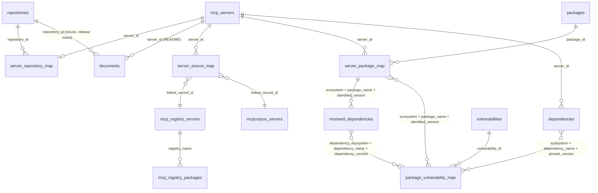

# MCP Sentinel — Sprint 1 Data Dictionary

This document describes every file written by `scripts/run_sprint1.py`. Raw source snapshots are kept in `data/raw/`: the DeepNLP JSON Lines file, and gzip-compressed JSON snapshots of the Official MCP Registry and MCPCorpus, each with a `*_source_metadata.json` file recording where and when it was obtained and its SHA-256 checksum. The staging tables in `data/staging/` follow a normalized relational design so they can be loaded into PostgreSQL in Sprint 2 with `COPY ... WITH (FORMAT csv, HEADER true)`. The processed table in `data/processed/` is a denormalized, one-row-per-server view intended for analysis and for the notebook.

General conventions used in all files:

- Column names are lowercase `snake_case`.
- Missing values are written as empty CSV fields, which PostgreSQL `COPY` reads as `NULL`. No placeholder strings such as `"N/A"` or `"unknown"` are used.
- Booleans are written as `True`/`False`, which PostgreSQL accepts for the `boolean` type.
- Timestamps are ISO 8601 in UTC (for example `2026-10-18T06:25:47Z`) and map to `timestamptz`.
- Lists that do not deserve their own table yet (for example aliases) are stored as text joined with `"; "`.
- Every table has a `source` column (the system that produced the row) and a `collected_at` column (when the underlying data was retrieved). These are the provenance fields required by our Sprint 1 plan.

## Entity relationship overview

An important design decision is that **several MCP servers can map to the same repository**. For example, the official `modelcontextprotocol/servers` monorepo contains many independent servers in different subdirectories. These servers keep separate `server_id` values and are connected to one shared `repositories` row through `server_repository_map`, together with their own `github_subpath`.

## Status vocabularies

These controlled values are used instead of free-text error messages so that later sprints can filter reliably.

| Column | Values | Meaning |
|---|---|---|
| `github_url_type` | `repository`, `repository_subpath`, `owner_only`, `not_github`, `invalid` | What kind of reference the DeepNLP `website` field contains |
| `lookup_status` (repositories) | `found`, `not_found`, `lookup_failed` | Result of `GET /repos/{owner}/{repo}` |
| `location_status` | `manifests_checked`, `location_not_found`, `repository_not_found`, `repository_lookup_failed`, `lookup_failed` | Whether the server's repository location (root or subdirectory) could be listed |
| `github_status` (enriched) | `mapped`, `subpath_not_found`, `repository_not_found`, `lookup_failed`, `ambiguous_owner_only_url`, `not_github` | Final GitHub mapping outcome per server |
| `registry_status` | `found`, `not_found`, `lookup_failed` | Result of the PyPI or npm registry request |
| `mapping_status` (server_package_map) | `verified`, `ambiguous`, `not_published`, `lookup_failed` | Whether a declared package is reliably the server's package (see below) |
| `mapping_status` (dependencies) | `declared`, `unidentified` | Whether the dependency name could be parsed from the manifest |
| `candidate_source` | `official_mcp_registry`, `repository_manifest` | Where the package name was declared |
| `version_source` | `official_mcp_registry`, `repository_manifest`, `registry_latest` | Where `identified_version` came from |
| `dependency_graph_status` | `found`, `not_found`, `lookup_failed` | Result of the deps.dev dependency graph request for a verified package version |
| `match_status` (server_source_map) | `matched`, `multiple_matches` | Whether the server matched exactly one record in the other inventory |
| `document_type` | `readme`, `release_notes`, `issue` | Kind of GitHub text document |
| `filter_reason` | empty (kept), `not_available`, `pull_request`, `bot_author`, `empty_or_too_short` | Why a document was filtered out of text analysis |
| `tag_format`, `tool_format` (MCPCorpus) | `json_array`, `comma_separated`, `empty`, `missing`, `invalid_json` | Original format of the tags/tools text in the corpus |
| `osv_status`, `package_vulnerability_status`, `vulnerability_assessment_status` | `known_vulnerabilities_found`, `no_known_vulnerabilities_found`, `api_failed`, `unknown_version`, `ambiguous_mapping`, `unknown_package_identity`, `not_assessed` | Result of the OSV.dev vulnerability lookup |
| `assessment_scope` | `package_and_dependencies`, `package_only`, `dependencies_only`, `none` | Which parts of a server were successfully checked against OSV.dev |
| `description_quality` | `ok`, `missing`, `web_boilerplate`, `fragment`, `too_short` | Heuristic quality flag for the scraped description |

**Package verification rule.** A package is marked `verified` in two cases. First, when the server's own Official MCP Registry entry (matched by repository and subfolder, exactly one match) lists the package and the package exists on PyPI or npm; the MCP Registry checks that the publisher controls the package, so this is recorded as `official_mcp_registry_lists_package`. Second, when all three of these conditions hold: (1) a `package.json`, `pyproject.toml`, or `setup.cfg` file at the server's repository location declares the package name, (2) the registry contains a package with that name, and (3) the registry metadata (npm `repository`/`homepage`, PyPI `project_urls`/`home_page`) links back to the same GitHub repository. Because repositories get renamed or transferred, both sides are compared by their current canonical name: the server's repository is resolved through the GitHub API, and when a registry link does not match directly it is also resolved through the GitHub API (which follows GitHub's rename redirects). `mapping_evidence` records which case applied (`registry_links_to_server_repository` or `registry_link_redirects_to_server_repository`). Name similarity alone is never used.

**Vulnerability status rule.** `known_vulnerability_count` is only filled when OSV.dev was successfully queried (`known_vulnerabilities_found` or `no_known_vulnerabilities_found`). For every other status it is `NULL`, never `0`, because a lookup that did not happen says nothing about security. When several statuses apply to one server, the server-level status is chosen with this precedence: `known_vulnerabilities_found` > `api_failed` > `no_known_vulnerabilities_found` > `unknown_version` > `ambiguous_mapping` > `unknown_package_identity` > `not_assessed`.

## data/staging/mcp_servers.csv

One row per DeepNLP MCP server record after cleaning. **Primary key:** `server_id`. **Foreign key:** `repository_id` → `repositories.repository_id` (nullable).

| Column | Type | Description |
|---|---|---|
| `server_id` | text, PK | Stable identifier built as `deepnlp:` + `publisher_id` |
| `source_file` | text | Raw file the record came from |
| `source_record_number` | integer | Position of the record in the raw file (1-based), for tracing back to `data/raw/` |
| `publisher_id` | text, unique | Original DeepNLP identifier (`pub-...`) |
| `server_name` | text | Cleaned `content_name` |
| `server_name_is_generic` | boolean | True when the name looks like link text (`here`, `more`, `demo video`, ...) |
| `website_url` | text | Website after whitespace cleaning (used for display) |
| `website_original` | text | Exact raw value, kept for traceability |
| `website_normalized` | text | Lowercase scheme and host, `www.` removed, fragment and trailing slash removed; used for duplicate checks |
| `website_host` | text | Host part of `website_normalized` |
| `website_is_valid` | boolean | URL has an `http`/`https` scheme and a dotted host |
| `website_is_github` | boolean | Website is a GitHub URL |
| `github_url_type` | text | See status vocabularies |
| `github_owner`, `github_repo` | text | Owner and repository parsed from the URL (original casing) |
| `github_ref` | text | Branch from a `/tree/<ref>/...` URL, otherwise null (default branch) |
| `github_subpath` | text | Subdirectory inside the repository for monorepo servers |
| `repository_id` | text, FK | `github:<owner>/<repo>` in lowercase |
| `repository_url` | text | Normalized repository URL `https://github.com/<owner>/<repo>` |
| `description` | text | Cleaned description (whitespace collapsed, leading list markers removed) |
| `description_original` | text | Exact raw description |
| `description_quality` | text | See status vocabularies |
| `field`, `sub_field` | text | DeepNLP category fields (constant in the current snapshot) |
| `snapshot_month` | date | DeepNLP `month` (`YYYYMM`) converted to the first day of that month |
| `bing_rank` | numeric | Flattened from the nested `statistic` object (`Bing Rank`) |
| `possible_duplicate_group` | text | Shared key (`name:...` or `website:...`) when the record may duplicate another; flag only |
| `source` | text | `deepnlp_huggingface` |
| `collected_at` | timestamptz | When the raw dataset was downloaded |

## data/staging/repositories.csv

One row per unique GitHub repository referenced by at least one server. **Primary key:** `repository_id`.

| Column | Type | Description |
|---|---|---|
| `repository_id` | text, PK | `github:<owner>/<repo>` as written in the dataset (lowercase) |
| `repository_url` | text | Normalized URL derived from the dataset |
| `lookup_status`, `http_status`, `lookup_error` | text, integer, text | Result of the GitHub API request |
| `collected_at` | timestamptz | When the GitHub response was retrieved |
| `full_name` | text | Current canonical `owner/name` returned by GitHub |
| `owner`, `repository_name` | text | Owner login and repository name (flattened from the nested `owner` object) |
| `html_url` | text | Canonical repository URL from GitHub |
| `description` | text | GitHub repository description (untrusted text, stored only) |
| `stars`, `forks`, `open_issues` | integer | Popularity and activity counters |
| `archived`, `is_fork` | boolean | Repository flags |
| `primary_language` | text | GitHub's detected primary language |
| `license` | text | SPDX identifier flattened from the nested `license` object |
| `default_branch` | text | Default branch name |
| `created_at`, `updated_at`, `pushed_at` | timestamptz | Repository timestamps |
| `repository_moved` | boolean | True when GitHub redirected to a different `owner/name` (renamed or transferred) |
| `days_since_last_push` | integer | Days between `pushed_at` and `collected_at` (maintenance signal) |
| `commit_count` | integer | Commits on the default branch (from the `Link` header of `/commits?per_page=1`) |
| `last_commit_at`, `days_since_last_commit` | timestamptz, integer | Date of the latest commit and days between it and `collected_at` |
| `contributor_count` | integer | Contributors including anonymous ones; null when GitHub refuses to count very large histories |
| `release_count`, `latest_release_tag`, `latest_release_at` | integer, text, timestamptz | Published GitHub releases |
| `source` | text | `github_rest_api` |

## data/staging/server_repository_map.csv

Links servers to repositories. One row per server that has a GitHub repository reference. **Primary key:** `server_id`. **Foreign keys:** `server_id` → `mcp_servers`, `repository_id` → `repositories`.

| Column | Type | Description |
|---|---|---|
| `server_id` | text, PK/FK | Server |
| `repository_id` | text, FK | Repository |
| `github_ref`, `github_subpath` | text | Location of this server inside the repository |
| `location_status` | text | See status vocabularies |
| `manifest_files` | text | Supported manifests found at the location (`package.json`, `pyproject.toml`, `setup.cfg`, `requirements.txt`) |
| `unsupported_manifest_files` | text | Other manifests found but not parsed in Sprint 1 (`setup.py`, `go.mod`, `Cargo.toml`, `pom.xml`, ...) |
| `manifest_fetch_errors` | text | Manifests that were listed but could not be downloaded/decoded |
| `manifest_parse_errors` | text | Manifests that were downloaded but could not be parsed |
| `source`, `collected_at` | text, timestamptz | Provenance of the directory listing |

## data/staging/packages.csv

One row per unique package name looked up on PyPI or npm. **Primary key:** `package_id`.

| Column | Type | Description |
|---|---|---|
| `package_id` | text, PK | `<ecosystem>:<normalized name>` (for example `PyPI:mcp-server-git`) |
| `ecosystem` | text | `PyPI` or `npm` (OSV.dev ecosystem names) |
| `package_name` | text | PEP 503 normalized name for PyPI, lowercase name for npm |
| `registry_status`, `http_status` | text, integer | Result of the registry request |
| `latest_version` | text | Latest version reported by the registry |
| `release_count` | integer | Number of published versions (PyPI: versions with uploaded files) |
| `summary` | text | Registry summary/description |
| `project_urls` | text (JSON) | Project links from the registry; can be loaded as `jsonb` |
| `registry_repository_ids` | text | GitHub repositories that the registry metadata links to |
| `latest_dependencies` | text | Dependencies declared by the latest published version |
| `source`, `collected_at` | text, timestamptz | `pypi_json_api` or `npm_registry` |

## data/staging/server_package_map.csv

One row per package declared for a server, either in its Official MCP Registry entry or in a manifest at its repository location. **Primary key:** (`server_id`, `package_id`). **Foreign keys:** `server_id` → `mcp_servers`, `package_id` → `packages`.

| Column | Type | Description |
|---|---|---|
| `server_id`, `package_id` | text | Keys |
| `ecosystem`, `package_name` | text | Copied from the package for convenient joins |
| `declared_name`, `declared_version` | text | Exactly as written in the registry entry or manifest |
| `candidate_source` | text | `official_mcp_registry` or `repository_manifest` |
| `manifest_file` | text | Manifest that declared the package (null for registry-listed packages) |
| `declared_name_is_valid`, `declared_version_is_valid` | boolean | Name follows PyPI/npm naming rules; version is a valid PEP 440 (PyPI) or semantic (npm) version |
| `declared_version_is_published` | boolean | The declared version exists on the registry |
| `mapping_status`, `mapping_evidence` | text | Verification outcome (see package verification rule) |
| `identified_version` | text | Version used for the OSV query (only for verified packages) |
| `version_source` | text | `candidate_source` value when the declared version is published, otherwise `registry_latest` |
| `latest_version` | text | Latest registry version |
| `collected_at` | timestamptz | Registry lookup time |
| `dependency_graph_status` | text | deps.dev result for the identified version (verified packages only) |
| `osv_status`, `known_vulnerability_count`, `osv_queried_at` | text, integer, timestamptz | OSV.dev outcome for this package version |

## data/staging/resolved_dependencies.csv

One row per dependency in the deps.dev resolved dependency graph of a verified package version. **Primary key:** (`ecosystem`, `package_name`, `package_version`, `dependency_ecosystem`, `dependency_name`, `dependency_version`). The first three columns join to `server_package_map` (`identified_version`).

| Column | Type | Description |
|---|---|---|
| `ecosystem`, `package_name`, `package_version` | text | The verified package version whose graph this is |
| `dependency_ecosystem`, `dependency_name`, `dependency_version` | text | A dependency with the exact version deps.dev resolved |
| `relation` | text | `direct` or `indirect` (transitive) |
| `source`, `collected_at` | text, timestamptz | `deps_dev_api` |
| `osv_status`, `known_vulnerability_count`, `osv_queried_at` | text, integer, timestamptz | OSV.dev outcome for the dependency version |

## data/staging/dependencies.csv

One row per dependency declared in a server's manifests (runtime dependencies only). **Primary key:** `dependency_id`. **Foreign key:** `server_id` → `mcp_servers`.

| Column | Type | Description |
|---|---|---|
| `dependency_id` | text, PK | Sequential id (`dep-00001`) assigned after a deterministic sort |
| `server_id` | text, FK | Server whose manifest declares the dependency |
| `manifest_file` | text | Manifest file |
| `ecosystem` | text | `PyPI` or `npm` |
| `dependency_name` | text | Normalized dependency name (null when the line could not be parsed) |
| `version_spec` | text | Version constraint as declared (for example `>=1.0.0`, `^3.24.1`) |
| `pinned_version` | text | Exact version when the constraint pins one version (`==1.2.3`, `1.2.3`), otherwise null |
| `collected_at` | timestamptz | When the manifest was retrieved |
| `mapping_status` | text | `declared` or `unidentified` |
| `osv_status`, `known_vulnerability_count`, `osv_queried_at` | text, integer, timestamptz | OSV.dev outcome; only pinned dependencies are queried |
| `source` | text | `github_rest_api` |

## data/staging/documents.csv

Unstructured GitHub text after cleaning: one README per mapped server location, the latest release notes per repository, and the ten most recently updated issues per repository. **Primary key:** `document_id`. **Foreign keys:** `server_id` → `mcp_servers` (READMEs), `repository_id` → `repositories`. The text is untrusted data; it is stored for later analysis and never executed or followed.

| Column | Type | Description |
|---|---|---|
| `document_id` | text, PK | `readme:<server_id>`, `release:<repository_id>:<tag>`, or `issue:<repository_id>#<number>` |
| `document_type` | text | `readme`, `release_notes`, or `issue` |
| `server_id`, `repository_id` | text | Generated metadata linking the document to its server or repository |
| `title`, `source_url`, `published_at` | text, text, timestamptz | File path, release name, or issue title; GitHub URL; publication date |
| `raw_char_count`, `cleaned_char_count`, `word_count` | integer | Length before and after text cleaning |
| `filter_reason` | text | Empty when the document is kept, otherwise why it was filtered out |
| `cleaned_text` | text | Text after removing HTML, badges, link/image markup, markdown syntax, and extra whitespace (code and configuration text is kept) |
| `source`, `collected_at` | text, timestamptz | `github_rest_api` |

## data/staging/mcp_registry_servers.csv

One row per server in the Official MCP Registry (latest version of each). **Primary key:** `registry_name`.

| Column | Type | Description |
|---|---|---|
| `registry_name` | text, PK | Reverse-DNS server name, for example `io.github.owner/server` |
| `title`, `description`, `version`, `website_url` | text | Server metadata as published |
| `repository_url`, `repository_source`, `repository_subfolder` | text | Declared source repository and monorepo subfolder |
| `repository_id` | text | `github:<owner>/<repo>` when the repository is on GitHub (join key to DeepNLP) |
| `status`, `published_at`, `updated_at` | text, timestamptz | Registry status and publication dates from `_meta` |
| `package_count`, `remote_count` | integer | Number of declared packages and hosted (remote) endpoints |
| `shares_repository_location` | boolean | Another entry points to the same repository and subfolder |
| `source`, `collected_at` | text, timestamptz | `official_mcp_registry` |

## data/staging/mcp_registry_packages.csv

One row per package declared by a registry entry (flattened from the nested `packages` array). **Primary key:** (`registry_name`, `package_position`). **Foreign key:** `registry_name` → `mcp_registry_servers`. The same package can appear several times in one entry with a different transport or version, so the package name alone is not a key.

| Column | Type | Description |
|---|---|---|
| `registry_name` | text, FK | Registry entry |
| `package_position` | integer | Position of the package in the entry's `packages` array (1-based) |
| `registry_type`, `identifier`, `version` | text | Package registry (`npm`, `pypi`, `oci`, ...), package name, and version as declared |
| `ecosystem`, `package_name` | text | Normalized OSV ecosystem and package name (npm and PyPI only) |
| `transport_type` | text | `stdio`, `streamable-http`, or `sse` |
| `environment_variable_count`, `secret_environment_variable_count` | integer | Environment variables the package expects, and how many are marked secret (API keys, tokens) |
| `source`, `collected_at` | text, timestamptz | `official_mcp_registry` |

## data/staging/mcpcorpus_servers.csv

One row per MCPCorpus server record after removing exact and id duplicates. **Primary key:** `corpus_id`.

| Column | Type | Description |
|---|---|---|
| `corpus_id`, `source_id` | text, integer | `mcpcorpus:<id>` and the original corpus id |
| `name`, `title`, `description`, `author_name` | text | Server metadata (cleaned) |
| `category`, `record_type` | text | Corpus category (for example `developer-tools`) and record type |
| `tags`, `tag_format` | text | Tags normalized to a `"; "`-joined lowercase list, and the original format |
| `tool_count`, `tool_names`, `tool_format` | integer, text, text | Tool definitions parsed from JSON text |
| `website_url`, `website_normalized`, `repository_id`, `github_subpath` | text | Listing URL and parsed repository location (join key to DeepNLP) |
| `shares_repository_location` | boolean | Another corpus record points to the same repository location |
| `github_full_name`, `stars`, `forks`, `open_issues`, `contributor_count`, `primary_language`, `license` | text, integer | Flattened from the nested `github` object (counts cast to nullable integers because records without a `github` object leave gaps) |
| `archived`, `has_docker`, `has_readme`, `has_requirements` | boolean | Flags from the nested `github` object (nullable) |
| `last_commit_at` | timestamptz | Last commit according to the corpus crawl |
| `has_server_command`, `has_remote_url` | boolean | The corpus lists an install command / a remote SSE endpoint |
| `source`, `collected_at` | text, timestamptz | `mcpcorpus` |

## data/staging/server_source_map.csv

Entity resolution between the DeepNLP inventory and the other two inventories. A DeepNLP server matches a record when the normalized repository id (or the repository's current canonical name) and the subdirectory are equal. **Primary key:** (`server_id`, `linked_source`, `linked_record_id`). **Foreign keys:** `server_id` → `mcp_servers`; `linked_record_id` → `mcp_registry_servers.registry_name` or `mcpcorpus_servers.corpus_id`.

| Column | Type | Description |
|---|---|---|
| `server_id` | text | DeepNLP server |
| `linked_source`, `linked_record_id` | text | `official_mcp_registry` or `mcpcorpus`, and the matched record |
| `match_key` | text | `<repository_id>|<subdirectory>` used for the match |
| `match_status` | text | `matched` or `multiple_matches` |
| `source`, `collected_at` | text, timestamptz | `entity_resolution` and run time |

## data/staging/vulnerabilities.csv

One row per OSV.dev vulnerability record returned for at least one queried package version. **Primary key:** `vulnerability_id`.

| Column | Type | Description |
|---|---|---|
| `vulnerability_id` | text, PK | OSV identifier (for example `GHSA-...`, `PYSEC-...`) |
| `vulnerability_group_id` | text | Shared id for OSV records that are aliases of each other; count distinct values of this column to avoid double counting |
| `lookup_status` | text | Result of `GET /v1/vulns/{id}` |
| `aliases`, `cve_ids` | text | All aliases, and the CVE identifiers among them |
| `summary` | text | Short description from OSV |
| `severity_cvss` | text | CVSS vectors as `<type>:<vector>` |
| `severity_label` | text | Qualitative severity from `database_specific.severity` (mainly GitHub advisories) |
| `affected_packages` | text | `<ecosystem>:<name>` values listed in the record |
| `published`, `modified`, `withdrawn` | timestamptz | Record dates |
| `source`, `collected_at` | text, timestamptz | `osv_api` |

## data/staging/package_vulnerability_map.csv

One row per (package version, vulnerability) match returned by OSV.dev. **Primary key:** (`ecosystem`, `package_name`, `package_version`, `vulnerability_id`). **Foreign key:** `vulnerability_id` → `vulnerabilities`. The (`ecosystem`, `package_name`, `package_version`) triple joins to `server_package_map` (`identified_version`), to `dependencies` (`dependency_name`, `pinned_version`), and to `resolved_dependencies` (`dependency_ecosystem`, `dependency_name`, `dependency_version`).

| Column | Type | Description |
|---|---|---|
| `ecosystem`, `package_name`, `package_version` | text | Queried package version |
| `vulnerability_id`, `vulnerability_group_id` | text | Matched vulnerability |
| `fixed_versions` | text | Versions listed as `fixed` for this package in the OSV record |
| `source`, `collected_at` | text, timestamptz | `osv_api` and query time |

## data/processed/mcp_servers_enriched.csv

One row per server (same rows as `mcp_servers`). This file combines the server record with its repository metadata, package mapping, and vulnerability summary. It contains every column of `mcp_servers` except the raw `*_original` text and provenance columns, plus:

| Column | Description |
|---|---|
| `location_status`, `manifest_files`, `unsupported_manifest_files` | From `server_repository_map` |
| `repository_lookup_status`, `repository_full_name`, `stars`, `forks`, `open_issues`, `archived`, `is_fork`, `primary_language`, `license`, `repository_created_at`, `repository_pushed_at`, `days_since_last_push`, `repository_moved`, `commit_count`, `last_commit_at`, `days_since_last_commit`, `contributor_count`, `release_count`, `latest_release_at` | From `repositories` |
| `registry_names`, `registry_match_status` | Matched Official MCP Registry entries |
| `corpus_ids`, `corpus_match_status`, `corpus_category`, `corpus_tool_count` | Matched MCPCorpus records; the category is filled only when all matched records agree |
| `github_status` | Final GitHub outcome (see status vocabularies) |
| `package_ids`, `package_mapping_status`, `identified_versions`, `latest_versions` | All declared packages for the server, joined with `"; "` |
| `package_vulnerability_status`, `package_known_vulnerability_count` | OSV outcome for the server's own package(s) |
| `declared_dependency_count`, `pinned_dependency_count`, `resolved_dependency_count` | Unique declared dependencies, exactly pinned dependency versions, and deps.dev-resolved dependency versions |
| `dependencies_assessed`, `vulnerable_dependency_count`, `dependency_known_vulnerability_count` | Pinned and resolved dependency versions checked by OSV.dev, how many are vulnerable, and their unique vulnerabilities |
| `known_vulnerability_count` | Unique vulnerabilities (alias-grouped) across the package and all checked dependencies; null when nothing was assessed |
| `assessment_scope`, `vulnerability_assessment_status` | What was assessed and the overall outcome |
| `enriched_at` | When the processed file was built |

## reports/

| File | Content |
|---|---|
| `sprint1_profile.md` | Generated profiling report with all Sprint 1 statistics |
| `missing_values.csv` | Per-column profile for every inventory (`dataset`), DeepNLP before and after cleaning (dtype, null count, blank/placeholder count, missing %, distinct values) |
| `duplicate_summary.csv` | Exact, identifier, URL, repository, and semantic duplicate checks |
| `data_quality_issues.csv` | Format inconsistencies, invalid values, and low-information columns with counts and handling |
| `cleaning_log.csv` | Every cleaning step with the number of records modified, flagged, or removed |
| `enrichment_summary.csv` | GitHub, document, source-linking, package, dependency, and OSV coverage metrics |
| `source_schemas.csv` | Schema extraction: every JSON field path in the three raw inventories with its value types and record coverage |
